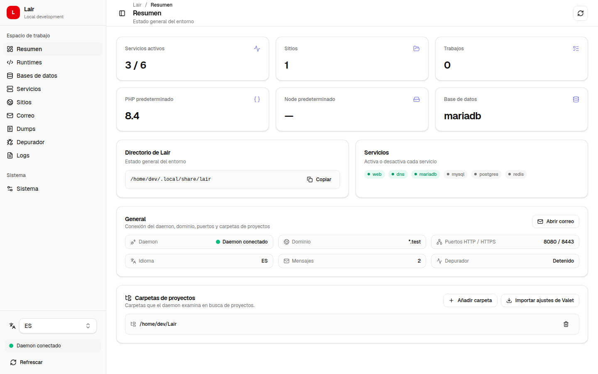
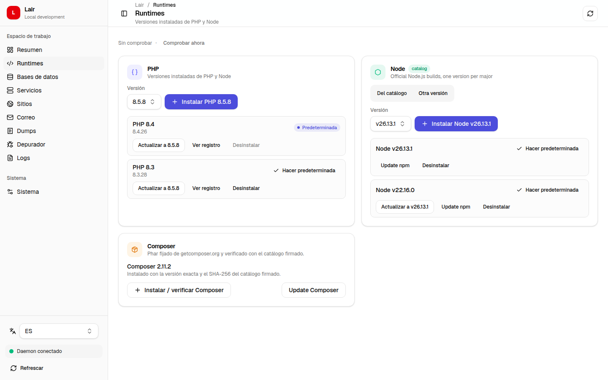
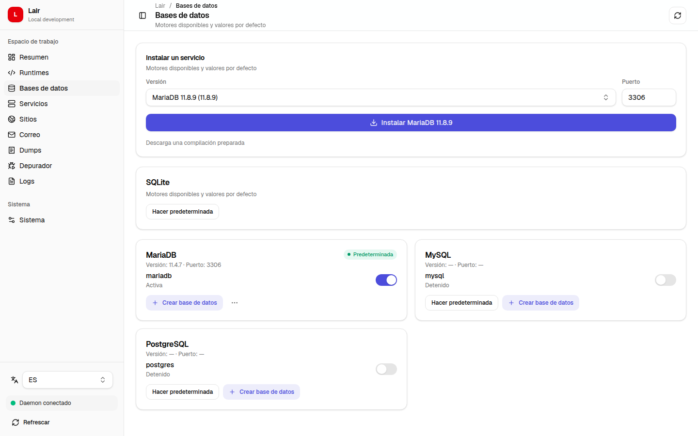
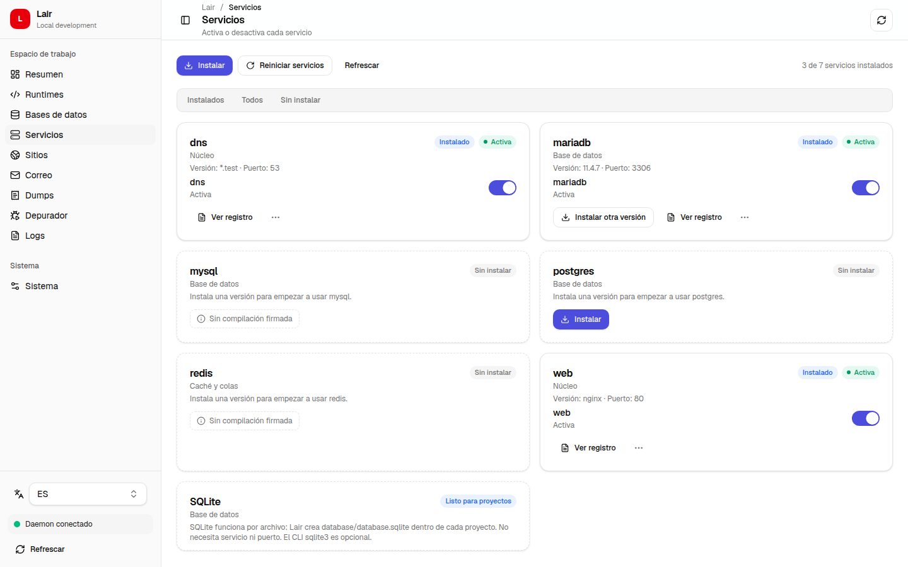
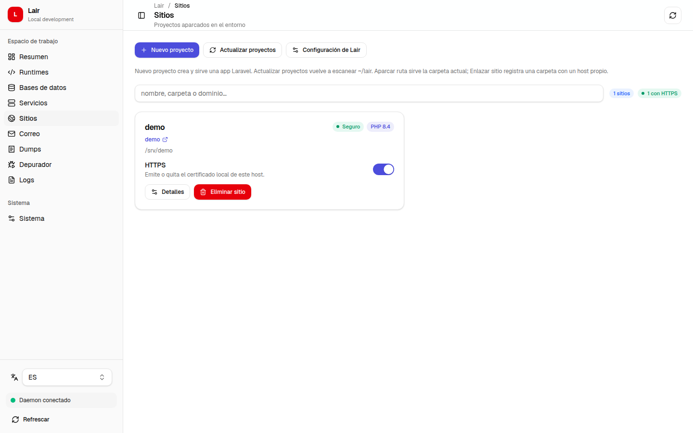
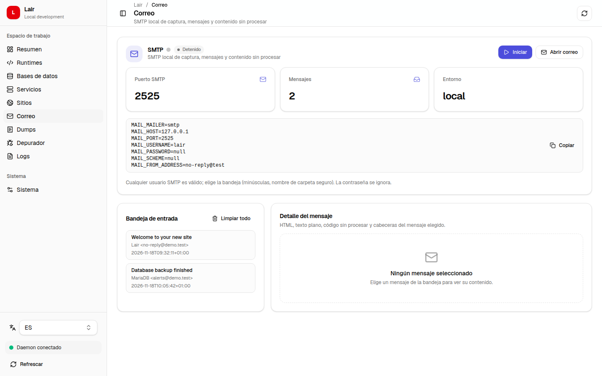
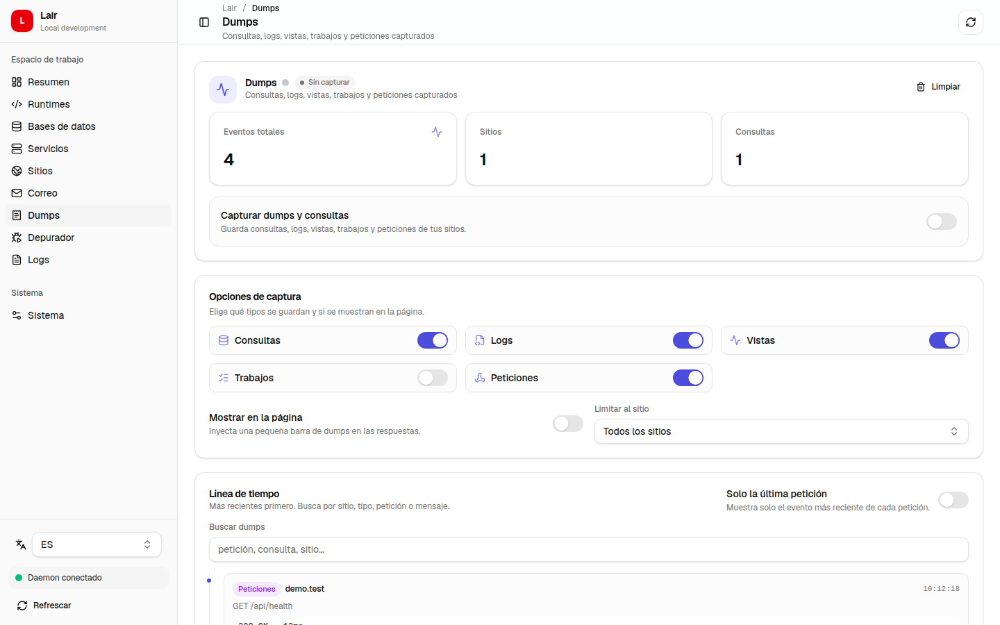
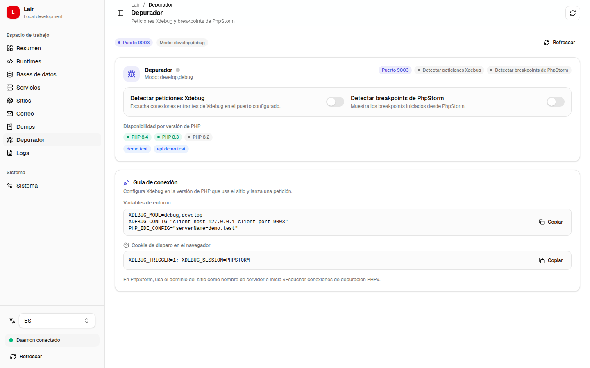
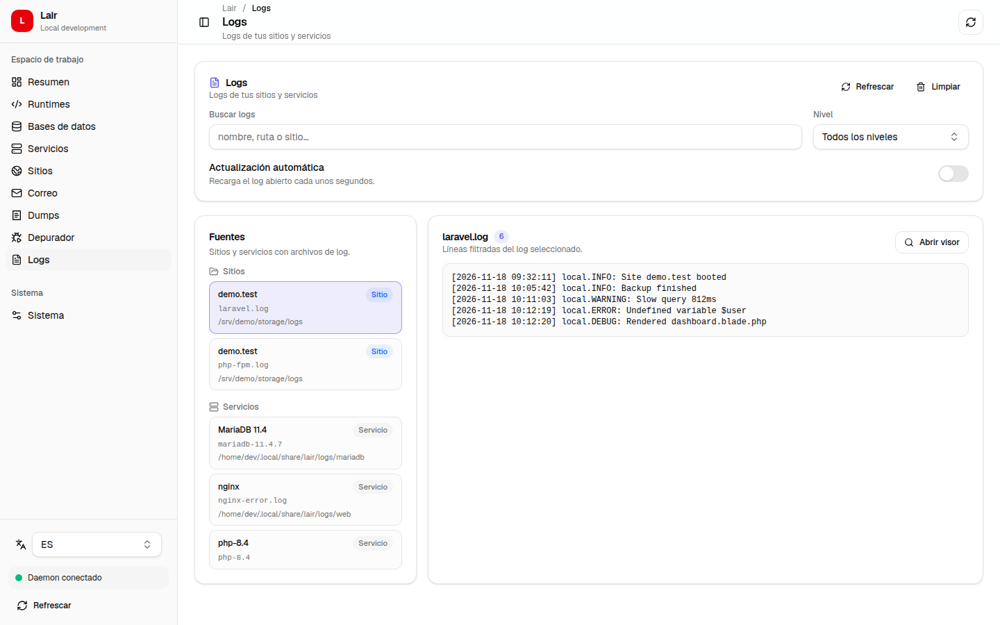
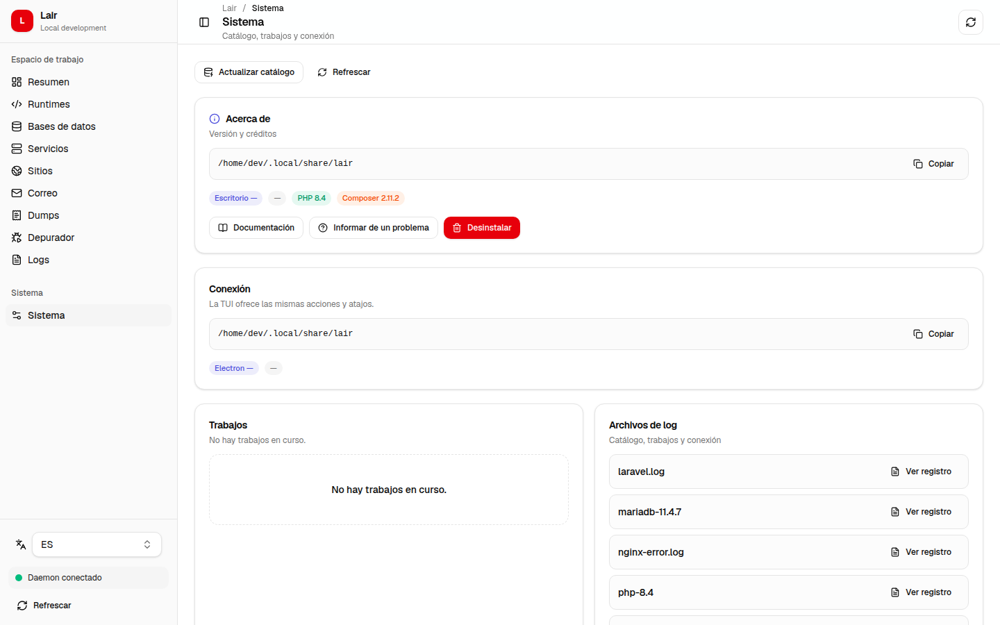

# Lair

Entorno de desarrollo local para **PHP / Laravel nativo** (sin Docker ni VM). Un solo binario Go reúne la CLI, el daemon y el punto de entrada de los shims: compilas una vez, configuras con dos variables y usas `lair` para todo.

> Estado: fases 1–6 implementadas y testeadas. Linux con `systemd-resolved` es la plataforma completa. El catálogo firmado incluido es **de ejemplo** (clave Ed25519 de desarrollo con la clave privada fuera de Git); no sirve para producción.

---

## En 30 segundos

```sh
# 1. compilar
export PATH="$HOME/.local/go/bin:$PATH"
cd lair && make build

# 2. configurar e instalar
export LAIR_HOME="$HOME/.local/share/lair"      # opcional: es el valor por defecto
./lair install
sudo "$LAIR_HOME/setup-privileged.sh"
sudo "$LAIR_HOME/trust-ca.sh" --add
sudo systemctl enable --now lair@$USER

# 3. usar
new shell                       # o: source ~/.bashrc
lair php install 8.4 && lair php use 8.4
lair node install                        # último LTS firmado: v26.13.1 (npm 11.20.0)
lair services install mariadb            # opcional: SQLite ya se instaló con `lair install`
node -v && npm -v && php -v
lair doctor                     # diagnóstico si algo no responde
```

---

## Índice

0. [Instalación](#instalación)
1. [Compilación y Makefile](#1-compilación-y-makefile)
2. [Configuración](#2-configuración)
3. [El comando `lair`](#3-el-comando-lair)
4. [Flujos de trabajo](#4-flujos-de-trabajo)
5. [Resolución de versiones](#5-resolución-de-versiones)
6. [Estructura de datos](#6-estructura-de-datos)
7. [Mapa de módulos](#7-mapa-de-módulos)
8. [Daemon, DNS y HTTPS](#8-daemon-dns-y-https)
9. [Seguridad](#9-seguridad)
10. [Solución de problemas](#10-solución-de-problemas)
11. [Guía detallada de módulos](#11-guía-detallada-de-módulos)
12. [Capturas de pantalla](#12-capturas-de-pantalla)
13. [Más documentación](#13-más-documentación)

---

## Instalación

### Binarios del release v1.0.1

Los paquetes publicados están en <https://github.com/LC-jhony/lair/releases/tag/v1.0.1>. Cada comprimido contiene `lair` (o `lair.exe` en Windows) y este README. **Verifica siempre el SHA-256** contra el fichero `SHA256SUMS` del release antes de ejecutar el binario. El paquete `.deb` de Linux incluye además la **app de escritorio Electron** y el comando `lair-desktop`; el icono *Lair* del menú la abre directamente. Los comprimidos `.tar.gz`/`.zip` solo contienen el binario CLI.

#### Linux x86_64 (amd64)

```sh
mkdir -p ~/.local/bin && cd /tmp
curl -fLO https://github.com/LC-jhony/lair/releases/download/v1.0.1/lair_1.0.1_linux_amd64.tar.gz
curl -fLO https://github.com/LC-jhony/lair/releases/download/v1.0.1/SHA256SUMS
grep ' lair_1.0.1_linux_amd64.tar.gz$' SHA256SUMS | sha256sum -c -
tar -xzf lair_1.0.1_linux_amd64.tar.gz
install -m 0755 lair ~/.local/bin/lair
lair --help
```

En **Linux arm64**, sustituye `amd64` por `arm64` en el nombre del artefacto. En Debian/Ubuntu instala el `.deb` (incluye la app de escritorio):

```sh
curl -fLO https://github.com/LC-jhony/lair/releases/download/v1.0.1/lair_1.0.1_amd64.deb
sudo apt install ./lair_1.0.1_amd64.deb      # usa arm64 en Raspberry Pi
lair-desktop                                 # abre la app de escritorio
```

#### macOS (Apple Silicon / Intel)

```sh
mkdir -p ~/.local/bin && cd /tmp
curl -fLO https://github.com/LC-jhony/lair/releases/download/v1.0.1/lair_1.0.1_darwin_arm64.tar.gz
curl -fLO https://github.com/LC-jhony/lair/releases/download/v1.0.1/SHA256SUMS
grep ' lair_1.0.1_darwin_arm64.tar.gz$' SHA256SUMS | shasum -a 256 -c
tar -xzf lair_1.0.1_darwin_arm64.tar.gz
install -m 0755 lair ~/.local/bin/lair
```

Para Intel, usa `lair_1.0.1_darwin_amd64.tar.gz`.

#### Windows (PowerShell)

```powershell
$asset = 'lair_1.0.1_windows_amd64.zip'
$base  = 'https://github.com/LC-jhony/lair/releases/download/v1.0.1'
Invoke-WebRequest -Uri "$base/$asset" -OutFile $asset
Invoke-WebRequest -Uri "$base/SHA256SUMS" -OutFile SHA256SUMS
$expected = (Select-String -Path SHA256SUMS -Pattern " $asset`$").Line.Split(' ')[0]
if ((Get-FileHash $asset -Algorithm SHA256).Hash.ToLower() -ne $expected) { throw 'SHA-256 no coincide' }
Expand-Archive $asset -DestinationPath .
$dir = "$HOME\.local\bin"
New-Item -ItemType Directory -Force -Path $dir | Out-Null
Move-Item lair.exe $dir -Force
[Environment]::SetEnvironmentVariable('Path', "$env:Path;$dir", 'User')
```

Para ARM64 usa `lair_1.0.1_windows_arm64.zip`.

### Desde el código fuente

Necesitas Go 1.26+; el bundle de la TUI ya viene incrustado, pero `lair tui` necesita Node 22+ en tiempo de ejecución.

```sh
git clone https://github.com/LC-jhony/lair.git
cd lair
export PATH="$HOME/.local/go/bin:$PATH"   # si Go no está en el PATH
make build
mkdir -p ~/.local/bin && install -m 0755 lair ~/.local/bin/lair
```

### Configuración inicial (una sola vez)

`lair install` crea shims, PATH, CA y descarga PHP, Node LTS y SQLite con barra de progreso. `LAIR_HOME` es opcional (por defecto `~/.local/share/lair`). Después **revisa** los scripts que genera y ejecútalos con elevación:

```sh
lair install

# Linux con systemd
sudo "$LAIR_HOME/setup-privileged.sh"
sudo "$LAIR_HOME/trust-ca.sh" --add
"$LAIR_HOME/trust-ca-user.sh" --add
sudo systemctl enable --now "lair@$USER"

# macOS: sustituye los cuatro comandos anteriores por
sudo "$LAIR_HOME/setup-privileged.sh"

# Windows (PowerShell elevado): sustituye por
powershell -NoProfile -ExecutionPolicy Bypass -File "$env:LAIR_HOME\setup-privileged.ps1"
```

Abre una terminal nueva para cargar el PATH y comprueba:

```sh
lair doctor && php -v && node -v && composer -V
```

---

## 1. Compilación y Makefile

### Requisitos de compilación

Necesitas **Go 1.26.0+** (`go.mod` fija `go 1.26.0`; en este entorno: `~/.local/go`, versión 1.27.4) y acceso a `go mod download` la primera vez. El runtime de Lair usa la biblioteca estándar; las dependencias externas son las del fallback de la TUI (`charmbracelet/bubbletea`, `bubbles`, `lipgloss` y `mattn/go-isatty` para detectar TTY). La TUI principal es un bundle React/Ink + termcn que se compila con Node 22+ y se incrusta en el binario; el usuario final no necesita Go ni Node para compilar, solo Node 22+ para ejecutar `lair tui`. Para compilar sin red, usa la caché de módulos ya descargada.

Si Go está instalado en `~/.local/go`, añádelo al PATH de tu shell:

```sh
export PATH="$HOME/.local/go/bin:$PATH"
go version        # go version go1.27.4 linux/amd64
```

### El Makefile

```makefile
GO  ?= go
BIN := lair

all: test build
build:      $(GO) build -o $(BIN) ./cmd/lair
test:       $(GO) test ./...
test-race:  $(GO) test -race ./...
vet:        $(GO) vet ./...
lint:       golangci-lint run      # si no está instalado, usa $(GO) vet ./...
coverage:   $(GO) test -coverprofile=coverage.out ./...
fmt:        $(GO) fmt ./...
clean:      rm -f $(BIN)
```

| Target | Comando que ejecuta | Para qué sirve |
|---|---|---|
| `make build` | `go build -o lair ./cmd/lair` | Genera `./lair`: CLI + daemon + `exec` en un único ejecutable. Es el target que normalmente usarás. |
| `make test` | `go test ./...` | Toda la suite unitaria (manifiesto, versiones, extracción segura, servicios, shims, API, DNS, PKI, web, dispatcher, bootstrap, uninstall). |
| `make vet` | `go vet ./...` | Análisis estático; debe salir sin mensajes. |
| `make lint` | `golangci-lint run` (o `go vet ./...` si no está instalado) | Linters de `.golangci.yml`: `errcheck`, `govet`, `ineffassign`, `staticcheck`, `unused` y `misspell`. |
| `make coverage` | `go test -coverprofile=coverage.out ./...` | Genera `coverage.out` (ignorado por Git) y muestra el porcentaje total. |
| `make fmt` | `go fmt ./...` | Formatea todo el código con `gofmt`. |
| `make test-race` | `go test -race ./...` | Detecta carreras; **requiere cgo y un compilador C (`gcc`)**. Si no tienes gcc, usa `make test`. |
| `make all` | `test` + `build` | Valida y compila de un golpe (es el target por defecto: basta con `make`). |
| `make clean` | `rm -f lair` | Borra el binario generado. |

> **CI:** `.github/workflows/ci.yml` ejecuta en cada push y pull request los jobs `go` (`go test ./...`, `go vet ./...`, `go test -race ./...` y `go build`) y `app` (`npm ci`, `test`, `typecheck`, `i18n:check`, `actions:check` y `build`, con Node 22). El CI **no publica releases**; la publicación sigue siendo manual con `scripts/create-release.sh`.

### Personalizar la compilación

Las variables se pueden sobreescribir en la línea de comandos:

```sh
make GO="$HOME/.local/go/bin/go" BIN=./lair-dev build     # ruta explícita de Go / otro nombre
make GO=go test                                           # usar el go del PATH
make clean build                                          # reconstruir desde cero
```

Cross-compilación (el manifiesto usa claves `linux-x64`, `linux-arm64`, etc.):

```sh
GOOS=linux   GOARCH=amd64 make build BIN=./lair-linux-x64
GOOS=linux   GOARCH=arm64 make build BIN=./lair-linux-arm64
GOOS=darwin  GOARCH=arm64 make build BIN=./lair-darwin-arm64
CGO_ENABLED=0 make build      # binario estático; recomendado para distribuir
```

Tras compilar, comprueba el binario:

```sh
./lair help
./lair status --json
```

> Instala el binario en una ruta **estable** (por ejemplo `~/.local/bin/lair`). Los shims guardan la ruta absoluta del ejecutable con el que se generaron: si luego borras el binario temporal con el que hiciste `lair install`, los shims dejarán de funcionar. Si eso pasa, vuelve a ejecutar `lair install` con el binario definitivo.

---

## 2. Configuración

### 2.1 Raíz de datos (`LAIR_HOME` / `XDG_DATA_HOME`)

Todo lo que Lair gestiona vive bajo una sola raíz. La precedencia es:

| Prioridad | Variable | Resultado |
|---|---|---|
| 1 | `LAIR_HOME` | Se usa tal cual (si es relativa, se convierte en absoluta). |
| 2 | `XDG_DATA_HOME` | `$XDG_DATA_HOME/lair` |
| 3 | — | `~/.local/share/lair` |

```sh
export LAIR_HOME="$HOME/.local/share/lair"     # valor por defecto; puedes omitirlo
export LAIR_HOME="/datos/lair"                  # raíz alternativa (disco, tests, etc.)
export XDG_DATA_HOME="$HOME/.local/share"       # equivalente estándar XDG
```

Comprueba la raíz que se está usando en cualquier momento:

```sh
lair status    # primera línea: "Lair home: ..."
lair doctor    # imprime home, bin, PATH y shims
```

### 2.2 Configuración persistente (`config.json`)

`<LAIR_HOME>/config.json` (permisos `0600`) es el estado de la instalación. **En producción solo lo escribe el daemon**; la CLI lo usa directamente únicamente en modo offline/bootstrap. Las escrituras son atómicas.

```json
{
  "version": 1,
  "installed": {
    "php/8.4": "N3",
    "node/22.11.0": "N1",
    "postgres/17.2": "N2"
  },
  "defaults": {
    "php": "8.4",
    "node": "22.11.0",
    "postgres": "17.2"
  },
  "ports": { "postgres": 5432 },
  "project_dirs": {
    "default": "/home/usuario/Lair",
    "dirs": ["/home/usuario/Lair"]
  },
  "sites": {
    "mi-app.test": {
      "path": "/home/usuario/Lair/mi-app",
      "php": "8.4",
      "node": "22"
    }
  }
}
```

| Campo | Significado | Se modifica con |
|---|---|---|
| `installed` | `"<paquete>/<versión>" → build` instalado. | `lair php/node/services install` |
| `defaults` | Versión activa de `php`, `node` y cada servicio. | `lair php use`, `lair node default`, `lair services use` |
| `ports` | Puerto asignado a cada servicio (uno activo por puerto). | `lair services install --port N` |
| `project_dirs` | **ProjectDirs**: carpeta por defecto (`~/Lair`) y lista de carpetas que se escanean en busca de proyectos. | `lair project dirs`, `lair migrate-dirs`, `lair import-valet` |
| `sites` | Sitios aparcados y sus versiones aisladas. | `lair park`, `lair link`, `lair isolate` |

`config.json` no se edita a mano: usa los comandos para que el daemon mantenga el estado coherente.

### 2.3 Configuración por proyecto (`.lairrc`)

`.lairrc` es un archivo de **texto versionable** que fija versiones para un proyecto. Se escribe con `lair pin` y lo lee el shim antes de elegir versión:

```ini
# .lairrc
php=8.4
node=22
```

```sh
lair pin php 8.4
lair pin node 22
git add .lairrc && git commit -m "Fijar versiones de Lair"
```

> **Compatibilidad:** los proyectos que todavía tengan `.flockrc` (nombre del diseño original) siguen funcionando: se lee como alternativa, tiene menos prioridad que `.lairrc`, y el primer `lair pin` migra su contenido al archivo nuevo sin borrar el antiguo. Lo mismo ocurre con el marcador `flock.json` de instalaciones PHP antiguas, que ahora se escribe como `lair.json`.

También se respetan `.nvmrc` y `.node-version` para Node (en ese orden, después de `.lairrc`). Los alias ambiguos como `lts/*` o `node` se ignoran deliberadamente. Para fijar una versión solo en un sitio aparcado, sin versionarla, usa `lair isolate php 8.3` (o `lair isolate php --off` para quitarla).

### 2.4 Variables de entorno

| Variable | Uso |
|---|---|
| `LAIR_HOME` | Raíz de datos (ver 2.1). |
| `XDG_DATA_HOME` | Base alternativa (`$XDG_DATA_HOME/lair`). |
| `LAIR_MANIFEST_BASE_URLS` | Mirrors del catálogo firmado separados por comas; se prueban en orden. Por defecto incluye `https://raw.githubusercontent.com/lair-sh/lair/main/catalog`. La confianza es de la firma, no del host. |
| `LAIR_COMPOSER_DOWNLOAD_URL` | URL alternativa de `composer.phar` (se sigue verificando el SHA-256). |
| `LAIR_COMPOSER_CHECKSUM_URL` | URL alternativa del `.sha256` de Composer (solo si no hay checksum en el catálogo). |
| `LAIR_COMPOSER_SHA256` | SHA-256 alternativo para `composer.phar` en pruebas/espejos. |

Las dos últimas son útiles en entornos cerrados o con mirror interno:

```sh
export LAIR_MANIFEST_BASE_URLS="https://cdn.lair.sh/stable,https://mirror.interno/lair/stable"
export LAIR_COMPOSER_DOWNLOAD_URL="https://mirror.interno/composer.phar"
export LAIR_COMPOSER_CHECKSUM_URL="https://mirror.interno/composer.phar.sha256"
lair update && lair install
```

### 2.5 PATH y perfiles de shell

`lair install` escribe un bloque delimitado por `# >>> lair >>>` / `# <<< lair <<<` en:

- `~/.bashrc` y `~/.zshrc` (guarda `[ -d "$bin" ]` para no contaminar PATH si se borra la raíz);
- `~/.config/fish/conf.d/lair.fish`;
- `~/.config/environment.d/lair.conf`.

Es idempotente y reversible: `lair uninstall` elimina exactamente esos bloques y respeta cualquier otra edición tuya. Para aplicarlo sin reiniciar:

```sh
source ~/.bashrc     # bash
source ~/.zshrc      # zsh
```

Si `node -v` no se reconoce, ejecuta `lair doctor --fix`: regenera los shims y los fragmentos de PATH, y te dice si falta el `export PATH="..."` exacto.

### 2.6 Scripts privilegiados (configuración del sistema)

`lair install` genera tres scripts que **tú debes revisar y ejecutar una vez**; Lair nunca los lanza automáticamente:

| Script | Se ejecuta con | Qué configura |
|---|---|---|
| `<LAIR_HOME>/setup-privileged.sh` | `sudo` | Unidad `lair@<usuario>.service`, regla polkit, `CAP_NET_BIND_SERVICE` (o `setcap` del binario) para los puertos 80/443, servicio **dnsmasq** en `127.0.0.1:53535` y drop-in de `systemd-resolved` (`DNS=127.0.0.1#53535`, `Domains=~test`), con copia de seguridad y reversión. |
| `<LAIR_HOME>/trust-ca.sh --add` | `sudo` | CA local en el store del sistema. |
| `<LAIR_HOME>/trust-ca-user.sh --add` | tu usuario | CA en Firefox/Chromium (requiere `certutil`). |

```sh
sudo "$LAIR_HOME/setup-privileged.sh"
sudo "$LAIR_HOME/trust-ca.sh" --add
"$LAIR_HOME/trust-ca-user.sh" --add
sudo systemctl enable --now lair@$USER
```

> El plan privilegiado instala dnsmasq **solo en `127.0.0.1:53535`** (nunca en el puerto 53 global) y escribe el drop-in de `systemd-resolved` con `Domains=~test`, de modo que solo `*.test` se reenvía al resolver local. Antes de tocar nada guarda una copia de la configuración previa; `revert-privileged.sh` la restaura si la resolución falla o si decides volver atrás. Lair **no ejecuta Valet como root** y el daemon corre como el usuario.

`lair uninstall` **elimina todo lo que Lair instaló**: shims y entradas de PATH, PHP, `composer.phar`, Node, los binarios de **todos los servicios (incluido MariaDB)**, la CA local, certificados, logs, caché y `config.json`. Por defecto conserva las bases de datos en `services/<id>/data/`; `--delete-data` también las borra. Genera `revert-privileged.sh` (y conserva los helpers con `--remove`) para deshacer los cambios privilegiados; con `--delete-data`, esos scripts se guardan en `$HOME` para que no desaparezcan al borrar la raíz.

> Lair sirve los sitios con **su servidor Go integrado** en `127.0.0.1`, sin paquetes del sistema: no hay servidor web externo, no se instala ninguno y no se escribe en `/etc`. No instala Laravel Valet, Mailcatcher ni bandeja nativa del sistema; el catcher SMTP es propio de Lair (ver [§3.12](#312-superficies-de-soporte-mail-dumps-debugger-y-logs)) y el uninstall no toca paquetes del sistema. Los hosts virtuales los genera el router web Go a partir de `config.json`, con los dominios/alias registrados y HTTPS con la CA local. El estado Web informa de los puertos, el enlace, el dominio y la redirección HTTP→HTTPS. Detalle en [§3.6](#36-sitios-y-https).

### 2.7 Catálogo firmado de ejemplo

Lair no consulta un índice editable: consume un **manifiesto firmado con Ed25519**. El binario lleva una copia embebida (`internal/assets/catalog.json` + `.sig`) y el repositorio publica la misma pareja en `catalog/`; por eso una instalación nueva funciona aunque `cdn.lair.sh` o `lair-builds.github.io` estén caídos. Un manifiesto del mirror con serial mayor sustituye al embebido; uno más antiguo se ignora.

> **Este catálogo es un ejemplo de desarrollo, no un feed de producción.** La clave pública está en `keys/public.ed25519` y la privada (`keys/private.ed25519`, `0600`) está excluida de Git. Para producción hay que generar un par nuevo, publicar solo la pública en el binario y firmar los manifiestos con la privada en un entorno controlado.

Incluye Node.js `v26.13.1` LTS “Lithium” (npm `11.20.0`, equivalente a `nvm install 26`) para Linux/macOS/Windows en `x64`/`arm64`; PHP `8.1.34`, `8.2.32`, `8.3.32`, `8.4.23` y `8.5.8` (CLI + FPM estáticos, `linux-x64`) y PHP `8.4.23` (CLI + FPM) para `macos-x64`/`macos-arm64` de `static-php-cli`; Windows usa los ZIP oficiales de `windows.php.net` y requiere el Visual C++ Redistributable x64; MariaDB `11.4.7` y `11.8.9`; y PostgreSQL `17.12.0` y `18.7.0` para `linux-x64`; Composer `2.11.2` (`composer.phar` oficial verificado por SHA-256). Todos los SHA-256 se verifican antes de extraer nada. MySQL no se incluye: los binarios oficiales requieren `libaio.so.1` del sistema y no arrancan en una instalación limpia.

**Node se instala y se gestiona con nvm, siempre a través de Lair.** El daemon no llama a nvm directamente: ejecuta `lair nvm install <versión>`, que es quien carga `~/.nvm/nvm.sh`. El panel Runtimes (y la TUI con `n`) acepta la sintaxis real de nvm: `26`, `lts`, `22.16.0` o `node`. Las versiones se leen de `~/.nvm/versions/node` y los shims (`node`, `npm`, `npx`) resuelven mediante `lair nvm exec`, respetando `.nvmrc`. Puedes usar el comando directamente:

```bash
lair nvm install 26
lair nvm install lts/*
lair nvm install 22.16.0
lair nvm ls
lair nvm current
```

Si nvm no está instalado, Lair avisa con la URL de instalación; no descarga ni ejecuta scripts remotos por su cuenta. En Windows (donde nvm no existe) se mantiene el instalador del catálogo firmado.

Formato (un build por `paquete → versión → plataforma`):

```json
{
  "schema": 1,
  "channel": "stable",
  "serial": 1001,
  "packages": {
    "node": {
      "v26.13.1": {
        "linux-x64": {
          "build": "N1",
          "url": "https://nodejs.org/dist/v26.13.1/node-v26.13.1-linux-x64.tar.gz",
          "sha256": "518674de2b621728a5e4486f5fb3b7d2900bb3cc4aa97969edaa463db99f9778",
          "size": 62904977,
          "published": "2026-11-17T00:00:00Z",
          "lts": "Lithium"
        }
      }
    }
  }
}
```

`url` admite `https://`, `http://` y `file://` (útil con mirrors internos); las relativas se resuelven contra `LAIR_MANIFEST_BASE_URLS`. El campo `lts` es el que permite a `lair node install` elegir el último LTS. Los campos opcionales `files` y `components` permiten publicar builds cuyo layout no coincide con el de Lair: `files` mueve miembros concretos del archivo (`php` → `bin/php`) y `components` fusiona otros archivos verificados en el mismo destino (`php-fpm` → `sbin/php-fpm`). Para volver a firmar el catálogo tras editarlo:

```sh
go run ./cmd/catalog-sign -in catalog/manifest.json -out catalog/manifest.json.sig -key keys/private.ed25519
cp catalog/manifest.json internal/assets/catalog.json
cp catalog/manifest.json.sig internal/assets/catalog.json.sig
```

La firma cubre los bytes exactos del JSON, así que cualquier edición sin volver a firmar se rechaza antes de parsearse. Tanto la desktop como la TUI leen estas mismas listas mediante la acción `versions` del daemon.

---

## 3. El comando `lair`

El binario es la **única** entrada: `lair <comando> [subcomando] [args] [flags]`. Si el daemon está activo, la CLI habla con él por un socket unix; si no, usa el mismo motor en proceso (modo offline). No hay dos implementaciones de la lógica.

### 3.1 Instalación y diagnóstico

| Comando | Descripción |
|---|---|
| `lair install` | Bootstrap local (shims, PATH, CA, Composer verificado), primera instalación de **PHP, Node LTS y SQLite** con barra de progreso, y generación de los scripts privilegiados (DNS/host virtual) para revisión y confirmación. Si no hay red o catálogo, avisa pero no aborta. |
| `lair uninstall [--delete-data]` | Elimina PHP, Composer, Node, todos los servicios, shims, PATH y CA local; conserva las bases de datos salvo `--delete-data`. También genera la reversión privilegiada. |
| `lair status [--json]` | Muestra home, estado del daemon, PHP, Node, servicios, puertos, sitios y jobs. `--json` para scripts. |
| `lair doctor [--fix]` | Comprueba PATH, shims y versiones; imprime cómo arreglarlo. Con `--fix` regenera shims y PATH. **Primer comando si algo no responde.** |
| `lair restart` | Reinicia todos los servicios supervisados activos. |
| `lair update` | Fuerza el refresco del catálogo firmado. |
| `lair logs [nombre]` | Muestra un log (`postgres`, `node-22-install`, ...) o lista los disponibles si no hay argumento. |
| `lair help` | Ayuda en pantalla. |

### 3.2 PHP

| Comando | Descripción |
|---|---|
| `lair php list` | Versiones instaladas; `*` marca la default. |
| `lair php install [versión] [--from RUTA]` | Instala una línea minor (`8.4`) o versión exacta. Sin versión, instala la más reciente del catálogo. `--from` acepta un directorio, `.tar.gz` o `.zip` locales. |
| `lair php use <minor>` (alias `lair use <minor>`) | Cambia la default global. |
| `lair php uninstall <minor>` | Desinstala una línea; nunca permite quitar la default. |

```sh
lair php install 8.3
lair php install 8.4 && lair php use 8.4
php -v && composer -V
```

### 3.3 Node

| Comando | Descripción |
|---|---|
| `lair node list` | Versiones instaladas; `*` marca la default. |
| `lair node install [versión] [--from RUTA]` | Instala con nvm mediante `lair nvm install <versión>`: sin versión (o `lts` / `latest-lts`) instala el último **LTS**; también acepta `26`, `node`, `latest` o `22.16.0`. `--from` instala desde un archivo local. La salida de nvm aparece en el job. |
| `lair node default <major>` | Fija la default (acepta major, p. ej. `22`). |
| `lair node update <major>` | Instala la última versión de esa major y la activa. |
| `lair node uninstall <major>` | Desinstala esa major. |
| `lair composer install` | Instala/verifica `tools/composer.phar` usando la versión y el SHA-256 del catálogo firmado (actualmente `2.11.2`, descargado de getcomposer.org). |
| `lair composer update` | Vuelve a descargar y verificar el phar. |
| `lair composer version` | Muestra la versión instalada. |
| `lair npm update` | Actualiza npm en el prefijo global de Node. |
| `lair ext [add <name>]` | Lista los requisitos `ext-*` de `composer.json` o instala una extensión con el PHP del proyecto. |
| `lair job retry <id>` | Reintenta un job fallido con los mismos parámetros. |

> **Configuración de Lair** es el botón de la pestaña **Sitios** de la desktop: configura el servidor Go (enlace, puertos HTTP/HTTPS, dominio y redirección), activa o desactiva HTTPS para `*.test`, muestra el estado de DNS/CA y gestiona las carpetas de proyectos. La acción `web` del daemon mantiene la paridad entre CLI, desktop y TUI con las operaciones `status`, `configure`, `https-on` y `https-off`.

```sh
lair node install                 # LTS actual: v26.13.1
lair node default v26.13.1
node -v && npm -v && npx --version
```

> Si `node -v` falla justo después de instalar, es un problema de PATH/shims, no de la instalación. Ver [solución](#10-solución-de-problemas).

### 3.4 Servicios

Forma general: `lair services <acción> <id> [versión] [flags]`.

| Acción | Ejemplo | Descripción |
|---|---|---|
| `list` (o sin acción) | `lair services list` | Estado de todos los servicios. |
| `install` | `lair services install postgres 17 --port 5432` | Descarga e inicializa; no cambia la activa si ya hay una. |
| `use` | `lair services use postgres 17.2` | Cambia la versión activa conservando los datos. |
| `update` | `lair services update postgres` | Instala la última, activa y reinicia. |
| `uninstall` | `lair services uninstall postgres 17.2 --delete-data` | Elimina la instalación; sin `--delete-data` conserva los datos. |
| `create-db` | `lair services create-db postgres laravel` | Crea una base de datos. |
| `default` | `lair services default sqlite\|mariadb\|mysql\|postgres` | Elige la BD predeterminada de nuevos proyectos (SQLite por defecto). |
| `restart` / `stop` | `lair services restart postgres` | Controla el supervisor. |

IDs disponibles: `postgres`, `mysql`, `mariadb`, `mongodb`, `redis`, `valkey`, `meilisearch`, `typesense`, `rustfs`.

Los servicios de búsqueda y almacenamiento usan los puertos 7700 (Meilisearch), 8108 (Typesense) y 9000 con consola en 9001 (RustFS). Sus credenciales son fijas y **solo para desarrollo**: `TYPESENSE_API_KEY=lair` y `rustfsadmin`/`rustfsadmin`. Typesense no tiene build para Windows y aparece como no disponible allí. PostgreSQL usa siempre el puerto 5432: no se elige al instalar ni se cambia después.

El catálogo firmado publica compilaciones para `mariadb`, `postgres`, `mongodb`, `valkey` 9.2.0 y `redis` 7.4.6 en Linux x64/arm64. Valkey y Redis comparten el puerto 6379: instala el segundo con `--port 6380`. La interfaz muestra todas las tarjetas y marca las que no tienen compilación para la plataforma actual («Not available on …»), en lugar de ocultarlas sin explicación.

SQLite no es un servicio supervisable: es una base de datos por archivo. Lair crea `database/database.sqlite` dentro de cada proyecto (opción `sqlite` en `lair new`) y la pestaña Services muestra una tarjeta informativa; no hay proceso ni puerto que iniciar. El CLI `sqlite3` 3.54.1 sí se instala desde el catálogo (`lair services install sqlite3`) y queda disponible como shim (`lair exec sqlite3 --version`). El catálogo publica el CLI para Linux x64 y macOS/Windows x64+arm64; Linux arm64 requiere compilarlo, así que aparece como no disponible en esa plataforma.

Valkey y Redis no tienen binario oficial para Windows (solo WSL/Docker), por lo que en Windows aparecen como no disponibles en lugar de ofrecer una instalación que no funcionaría. SQL Server no se implementa deliberadamente: exige root o Docker y no encaja en el modelo de servicios locales de Lair.

El catálogo permite canales `stable`, `beta` y `experimental` mediante `LAIR_CHANNEL`; cada canal tiene su propio `manifest[-canal].json`, firma, caché y contador de serial, y no acepta un manifiesto caducado ni con serial menor. `.github/workflows/binaries.yml` verifica las URLs de los artefactos, incrementa el serial, actualiza la caducidad y vuelve a firmar el catálogo con la clave privada del secreto `LAIR_SIGNING_KEY`.

Los clientes (`psql`, `mysql`, `redis-cli`, `valkey-cli`, `mongosh`, ...) también son shims e inyectan automáticamente host, puerto y usuario del servicio activo:

```sh
lair services install postgres 17
lair services create-db postgres laravel
psql -d laravel            # apunta a 127.0.0.1:5432 sin configurar nada
```

### 3.5 Proyectos Laravel

Lair puede crear un proyecto Laravel completo con una sola acción del daemon
(`project`), compartida por la desktop, la TUI y la CLI:

| Comando | Descripción |
|---|---|
| `lair project info` | Muestra instalador Laravel, versiones de PHP/Composer/Node, drivers PDO, gestores Node, motores de BD disponibles y la carpeta de proyectos. |
| `lair project dir [ruta]` | Muestra o fija la carpeta por defecto donde se crean los proyectos. Por defecto `~/Lair` (**L mayúscula**); nunca se usa el directorio actual ni `$LAIR_HOME`. Es un atajo de `lair project dirs default`. |
| `lair project dirs [list\|add <ruta>\|remove <ruta>\|default <ruta>]` | Gestiona **ProjectDirs**: lista, añade, quita o fija la carpeta por defecto. Las rutas deben ser absolutas y estar fuera de `$LAIR_HOME`. |
| `lair migrate-dirs` | Migra la carpeta anterior `~/lair` a `~/Lair`: mueve los proyectos y registra sus sitios como aparcados. También se ejecuta automáticamente al arrancar si detecta `~/lair`. |
| `lair import-valet` | Importa, **en solo lectura**, `~/.valet/config.json` y `~/.valet/Sites`: registra como sitios aparcados las rutas y dominios que allí aparecen, sin modificar esos archivos ni instalar o ejecutar Valet. |
| `lair new <nombre> [opciones]` | **Comando oficial** para crear un proyecto Laravel. Prepara la BD, escribe `.env` y registra `<nombre>.test`. Sin `--parent`, usa `~/Lair`. |
| `lair project new <nombre> [opciones]` | Alias de `lair new`, mantenido por compatibilidad. |

Cualquier proyecto que aparezca en la carpeta configurada (`~/Lair` por defecto) se detecta automáticamente: la pestaña **Sites** lo muestra como `<nombre>.test` aunque se haya creado con `laravel new` directamente. Se reconocen las carpetas que contengan `artisan` o `composer.json`; los sitios enlazados explícitamente no se sobrescriben. |

```sh
lair project new blog --stack=livewire --database=mariadb --db-name=blog_dev --secure
# La contraseña se pide sin eco; también puede pasar en LAIR_DB_PASSWORD.
```

El asistente de la desktop (**Sites → New project**) y la TUI (`C` en Sitios)
ofrecen las mismas opciones: nombre, carpeta padre (campo de texto), HTTPS,
interfaz, autenticación, framework de pruebas, gestor Node, Git y base de datos.
`laravel/installer` se instala en un `COMPOSER_HOME` aislado de Lair la primera
vez; nunca se toca el Composer global del usuario. Las credenciales viajan por
variables de entorno `DB_*` y nunca aparecen en argumentos ni en los registros
del job. El progreso, el log en vivo y la cancelación reutilizan `job`, `logs` y
`job-cancel`.

Cuando la base de datos es gestionada por Lair (MariaDB, MySQL o PostgreSQL),
el asistente arranca el servicio si está parado y crea la BD antes de que
Laravel ejecute las migraciones. SQL Server no es gestionado por Lair: en ese
caso Lair avisa y solo escribe las credenciales en `.env`.

#### ProjectDirs, `migrate-dirs` e `import-valet`

`config.json` guarda un bloque **`project_dirs`** (tipo **`ProjectDirs`**) con la carpeta por defecto y la lista de carpetas que se escanean:

```json
"project_dirs": {
  "default": "/home/usuario/Lair",
  "dirs": ["/home/usuario/Lair"]
}
```

- **`DefaultProjectsDir` es `~/Lair`** (con L mayúscula), siempre fuera de `$LAIR_HOME`. Si la carpeta no existe, Lair la crea y la registra como aparcada: sus proyectos aparecen en **Sites** como `<nombre>.test` sin que cambie la página.
- Si existe la carpeta anterior `~/lair`, Lair migra automáticamente los proyectos a `~/Lair` y reemplaza sus registros; `lair migrate-dirs` fuerza la migración cuando se necesita. El contenido se conserva y la carpeta antigua no se borra sin confirmación.
- `lair import-valet` lee `~/.valet/config.json` y `~/.valet/Sites` **solo para leer**: añade los sitios aparcados con sus rutas y dominios, sin escribir en esos archivos, sin instalar Valet y sin ejecutarlo como root.
- Las mismas operaciones están en el daemon dentro de la acción `project`, campo `op`: `dirs-list`, `dirs-add`, `dirs-remove`, `dirs-default`, `migrate-dirs` e `import-valet`. En la TUI se agrupan bajo la tecla **`F`**. La acción `site` y el detalle de **Sites** no cambian.

### 3.6 Sitios y HTTPS

| Comando | Descripción |
|---|---|
| `lair park` | Registra el directorio actual como `<nombre>.test`. |
| `lair link <nombre> [ruta]` | Registra un sitio con host explícito (por defecto, el directorio actual). |
| `lair unlink <nombre>` | Quita el sitio del router sin borrar sus archivos. Para borrar también la carpeta usa la acción `site` (`op: delete`, `delete_files: true`) o la tecla `X` de la TUI, siempre tras confirmación. |
| `lair secure [nombre]` | Emite certificado para el sitio y su wildcard con la CA local. Sin nombre, detecta el sitio del directorio actual. |
| `lair isolate php\|node <versión\|--off>` | Fija o quita una versión solo para ese sitio (config.json, prioridad máxima). |

La pestaña **Sites** de la desktop muestra una tarjeta por proyecto con el **nombre del proyecto** y su **host virtual** (`<nombre>.test`) como enlace abrible en el navegador, usando el esquema y puerto configurados en **Web**. Cada tarjeta permite activar/desactivar **HTTPS** del sitio (emite o retira el certificado local), abrir el **detalle del sitio** (las siete pestañas descritas abajo) y quitar el sitio. El botón **Refresh projects** vuelve a escanear la carpeta de proyectos; los cambios se guardan en `config.json` y se aplican al host virtual.

Cada sitio tiene un estado **enabled**. Desactivarlo (`site` con `op: set-enabled` y `enabled: false`) no borra el proyecto ni su registro: Lair retira su host virtual del router web Go. Reactivarlo (`enabled: true`) vuelve a publicarlo desde `config.json`. El toggle está en el detalle de **Sites** de la desktop y en la TUI; desde el Overview se puede pulsar **View generated vhost** (tecla **`V`** en la TUI) para inspeccionar exactamente el contenido generado, que también se obtiene con `op: config`.

Cuando el **root detection** no devuelve `ok` —raíz ausente, carpeta vacía o `index.php` en la raíz en lugar de `public/index.php`— el vhost sirve la página de estado **`not-configured.html`** en lugar de pasar la petición a PHP-FPM. Es una página genérica con el host solicitado, la ruta esperada del front controller **dentro de cada proyecto** (`<raíz>/public/index.php`) y sugerencias (`root_state`, `root_suggestions`); no expone rutas internas de `LAIR_HOME`, tokens ni valores del `.env`.

> **¿Por qué no hay configuración en `/etc`?** El enfoque clásico de los servidores web escribe cada sitio en un árbol del sistema y lo activa con enlaces simbólicos. Lair no sigue ese patrón: el daemon corre como el usuario y no tiene privilegios en caliente, y los hosts virtuales los genera el servidor Go integrado en memoria a partir de `config.json`. Activar o desactivar un sitio cambia su estado en el router, sin crear ni quitar enlaces ni archivos en `/etc`. Así no se toca la configuración de la distro, no se instala ningún paquete web y no hay configuración externa que validar. La decisión y las alternativas están en el [ADR 009](docs/adr/009-virtual-hosts-en-servidor-go.md).

#### Detalle de sitio: siete pestañas

Al abrir un sitio se muestra un detalle con **siete pestañas**, alimentado por la acción `site` del daemon (no hay lógica duplicada en la desktop):

| Pestaña | Qué muestra |
|---|---|
| **General (Overview)** | Framework, tipo, URL, estado **enabled** (con toggle), **raíz detectada** (`root_state`, `root_suggestions`) y su página de estado, **dominios/alias**, HTTPS y avisos (`problem` / `notice`); botón **View generated vhost**. |
| **Entorno** | Entradas del `.env` del sitio: los secretos llegan con `value` vacío y `secret: true`, `set` indica si la clave existe; permite editar valores con `env-set`. |
| **Base de datos** | Driver, host, puerto y nombre de la BD; usuario y contraseña enmascarada; permite cambiar el driver y crear bases de datos. |
| **Correo (Mail)** | Configuración SMTP para el catcher integrado (`127.0.0.1:2525`) y acceso al pane Mail. |
| **Colas (Queues)** | Estado de los servicios (solo lectura) y acceso a los registros. |
| **PHP y Node** | Versión resuelta y su origen (`php_source`, `php_file`, `node_source`, `node_file`), con botones de pin e isolate por sitio. |
| **Registros (Logs)** | Logs del sitio filtrados por origen (`logSources` + `logs`). |

> Los **dominios/alias** y el **root detection** se muestran en General y se editan con la acción `site` (`op: domains`). El estado **enabled** se alterna con `op: set-enabled`: un sitio desactivado no genera vhost. El botón **View generated vhost** (TUI `V`, `op: config`) muestra el host virtual generado, que no contiene secretos. Cuando `root_state != ok` se sirve `not-configured.html` en lugar de pasar la petición a PHP. Los **puertos, el enlace y el dominio** del servidor se consultan en el pane **Web** y en la acción `web`. La carpeta de un sitio **nunca se borra sin confirmar en la interfaz**: `delete` solo elimina archivos con `delete_files: true`, y el motor valida que la ruta registrada sea absoluta, esté fuera de `LAIR_HOME` y no sea un enlace simbólico. `lair unlink` sigue siendo no destructivo. Las variables de entorno se enmascaran en el servidor y los secretos nunca se devuelven en `status`.

#### Acción `site` del daemon

Como `mail`, `dumps` y `debugger`, `site` usa el sobre `{ "action": "site", "payload": { ... } }` del bridge `POST /api` (o el `Caller` en modo offline). El campo `op` selecciona la operación:

```json
{ "action": "site", "payload": { "op": "detail", "name": "mi-app.test" } }
{ "action": "site", "payload": { "op": "env", "name": "mi-app.test" } }
{ "action": "site", "payload": { "op": "env-set", "name": "mi-app.test", "key": "APP_ENV", "value": "local" } }
{ "action": "site", "payload": { "op": "domains", "name": "mi-app.test", "domains": ["www.mi-app.test", "mi-app.local"] } }
{ "action": "site", "payload": { "op": "set-enabled", "name": "mi-app.test", "enabled": false } }
{ "action": "site", "payload": { "op": "config", "name": "mi-app.test" } }
{ "action": "site", "payload": { "op": "delete", "name": "mi-app.test", "delete_files": true } }
```

| `op` | Campos | Respuesta (`SiteResult`) |
|---|---|---|
| `detail` (por defecto) | `name` | `detail`: vista completa del sitio (sin secretos) para el detalle de siete pestañas. |
| `env` | `name` | `env`: entradas de `.env` con los valores secretos enmascarados. |
| `env-set` | `name`, `key`, `value` | `output`: solo el nombre de la clave; el valor nunca se registra. |
| `domains` | `name`, `domains` | `domains`: lista normalizada; actualiza `config.json` y recarga sitios/web. |
| `set-enabled` | `name`, `enabled` | `detail`: vista actualizada con el nuevo `enabled`; aplica sitios/web. Con `enabled: false` se retira el host virtual del router. |
| `config` | `name` | `config`: texto del vhost generado; vacío si el sitio está desactivado. |
| `delete` / `unlink` | `name`, `delete_files` | `output`: `"sitio eliminado"`. Con `delete_files: true` borra también la carpeta. |

La fuente autoritativa del contrato es `SiteRequest` / `SiteResult` en `internal/engine/site.go`, reexportado por `internal/daemon/protocol.go`. El `detail` incluye `enabled` y `root_state`; el router web Go usa esos campos para decidir si publica el host virtual o sirve `not-configured.html`. Los errores están tipados (`ErrInvalidSiteName`, `ErrSiteNotFound`, `ErrInvalidEnvKey`, `ErrUnsafeSitePath`) para que los clientes los clasifiquen sin depender del texto. Los hosts virtuales se derivan de `config.json` y se aplican en caliente al servidor Go integrado, sin archivos de configuración externos.

```sh
cd ~/proyectos/mi-app
lair park                  # https://mi-app.test
lair secure mi-app.test
lair isolate php 8.3       # este sitio usa 8.3 aunque la default sea 8.4
lair isolate php --off
lair unlink mi-app.test    # quita el sitio, conserva los archivos
```

### 3.7 Pines de proyecto

```sh
lair pin php 8.4           # escribe php=8.4 en .lairrc del directorio actual
lair pin node 22           # añade node=22
lair pin root /srv/apps    # añade root=... (raíz de datos alternativa para este proyecto)
lair unpin php             # quita una entrada; admite php|node|root
lair isolated              # muestra el aislamiento activo del directorio actual
```

`root=` redirige la raíz de datos del proyecto (por ejemplo, dónde se crea `database/database.sqlite`) y debe ser una ruta absoluta validada por el motor. `isolate` es distinto de `pin`: fija la versión **solo para el sitio aparcado** en `config.json`, sin versionarla en `.lairrc`.

### 3.8 Daemon

```sh
lair daemon --foreground   # primer plano, para desarrollo
```

Flags: `--no-web`, `--no-dns`, `--no-api`, `--no-desktop`, `--desktop-port N`, `--dns-port`, `--http-port`, `--https-port`, `--domain` ( `--no-ui` y `--ui-port N` siguen aceptados como alias). Los puertos web por defecto son **80/443** (con `CAP_NET_BIND_SERVICE` o `setcap`); `--http-port`/`--https-port` permiten usar 8080/8443 u otros sin capacidad. El DNS permanece en `--dns-port 53535` por defecto. Sin `--foreground`, implica que el daemon lo gestiona systemd (`lair@<usuario>.service`).

```sh
lair daemon --foreground --no-web --no-dns
lair daemon --foreground --desktop-port 9800
```

### 3.9 App nativa y lanzador (`lair desktop`)

No hay interfaz web. El daemon expone un **bridge HTTP local** para la app nativa de Lair (Electron + React, en `app/`), en `127.0.0.1:9797` por defecto. `lair desktop` (alias `lair ui`) arranca el daemon si hace falta e imprime los datos de conexión; la app los lee directamente.

```sh
lair desktop
```

- El bridge publica `POST /api` con `{action, payload}` y cabecera `X-Lair-Token`. No sirve HTML, CSS ni JS; solo llama al mismo `Dispatcher` que usa la CLI.
- El token se escribe en `$LAIR_HOME/run/desktop.token` (`0600`) y la URL base en `$LAIR_HOME/run/desktop.url` (`0600`). El token nunca viaja en la URL: se rechaza el fallback por query y se acepta solo desde orígenes locales/Electron (`null`, `localhost`, `127.0.0.1`).
- El proceso principal de Electron lee esos archivos y expone `window.lairDesktop.connect()` al renderer con `contextIsolation`; el renderer no tiene acceso a filesystem.
- La app adopta el estado que devuelve el daemon, usa jobs con polling y no instala nada por sí misma. Cada texto visible es una clave de `app/lang/<código>/app.json` (en, es, cs).
- El bridge se desactiva con `lair daemon --foreground --no-desktop` y su puerto se cambia con `--desktop-port N`.
- El sidebar organiza **diez panes**: **Resumen** (antes *Overview*), **Runtimes**, **Bases de datos**, **Servicios**, **Sitios**, **Correo (Mail)**, **Dumps**, **Depurador (Debugger)**, **Logs** y **Sistema** (antes *About*). Mail, Dumps, Debugger y Logs son panes del sidebar, **no ventanas flotantes ni una bandeja nativa**: se decidió mantener todo dentro de la misma ventana para no duplicar estado ni atajos. Los atajos **1**–**9** saltan directamente a cada pane y **I** abre el diálogo de instalación de servicios.
- El paquete `.deb` instala `/usr/share/applications/lair.desktop` e `/usr/share/icons/hicolor/scalable/apps/lair.svg`. Tras instalar, cierra sesión y vuelve a entrar (o ejecuta `update-desktop-database`) para que el icono aparezca en el menú.

### 3.10 Dashboard de terminal (`lair tui`)

Si prefieres la terminal, `lair tui` (alias `lair dashboard`) abre un panel interactivo construido con **React/Ink y [termcn](https://termcn.dev)**: los mismos diez panes de la navegación lateral que la app de escritorio (**Overview**, Runtimes, Databases, Services, Sites, Mail, Dumps, Debugger, Logs y System), con los mismos textos, i18n (es/en/cs) y acciones del daemon. El bundle se compila en `app/tui/` con componentes de termcn (Card, Badge, Sidebar, KeyValue, Toggle, StatusMessage…) y se incrusta en el binario Go (`internal/assets/tui.mjs`), así que `lair tui` no necesita `node_modules`. Requiere Node 22+ (usa el PATH o el gestionado por nvm); si no está disponible cae al panel anterior de **Charmbracelet** (Bubble Tea, Bubbles, Lip Gloss, Huh, Glamour), que tiene **nueve panes** (Resumen, Runtimes, Bases de datos, Servicios, Sitios, Correo, Dumps, Debugger y Sistema): los registros se consultan con **`v`**, no son un pane. El fallback con `1`–`9` salta al pane correspondiente y `I` instala un servicio. Si la shell no ofrece un TTY real (IDE, runners), `lair tui` abre la TUI dentro de un PTY con `script(1)` para que Ink pueda activar el modo raw; en Windows sin `script(1)` muestra el estado en texto plano. Para reconstruirlo tras cambiar la TUI: `cd app && npm run tui:build`. Verifica tipos con `npm run tui:typecheck`.

Además de `1`–`9` (ir al pane), `I` (instalar servicio), `n` (Node LTS), `p` (PHP), `m` (MariaDB), `u` (catálogo), `s` (servicios), `r` (refrescar) y `q` (salir), ofrece `d` (predeterminada), `y` (usar versión), `z` (desinstalar), `b` (crear BD), `v` (logs), `x` (cancelar trabajo), `a`/`e`/`o` (aparcar/enlazar/desvincular), `c` (certificado), `g` (pin) e `i` (aislar). Las mayúsculas **`M` (Mail), `D` (Dumps), `B` (Debugger), `E` (detalle de sitio) y `X` (borrar sitio)** abren las superficies avanzadas; no confundirlas con las minúsculas `m` (MariaDB), `d` (default), `b` (crear base de datos) y `e` (enlazar sitio). La tecla **`E`** muestra un subconjunto del detalle de sitio de la desktop —Overview (URL, rutas, PHP, Node, BD, HTTPS, estado de `root`, dominios y avisos) y Environment (valores secretos enmascarados)— reutilizando la acción `site`; `v` abre los registros del sitio. La tecla **`X`** pide confirmación para desvincular el sitio y permite borrar también su carpeta (`delete_files: true`). La tecla **`V`** (mayúscula) muestra el **vhost generado** del sitio seleccionado y la tecla **`t`** (desde el detalle `E`) alterna su estado **enabled/disabled** (con confirmación, `op: set-enabled`): al desactivar, Lair retira el host virtual del router web Go. La tecla `v` sigue abriendo registros y el pane **Logs** añade el filtro por `sources`.

```sh
lair tui          # o: lair dashboard
```

Cuando stdin no es un TTY (CI, pipes), imprime el mismo estado en texto plano y termina, en lugar de dejar una pantalla completa colgada. Usa el mismo `Dispatcher` que la app nativa y la CLI, así que no hay acciones exclusivas de ninguna interfaz; `app/scripts/check-actions.mjs` verifica en CI que cada acción del cliente desktop exista en el daemon. Las instalaciones lanzadas desde la TUI o la app regeneran los shims y el PATH al terminar, de modo que `node -v`/`npm -v` funcionan sin pasos extra.

### 3.11 `exec` (interno, no lo llames a mano)

Cada shim contiene `exec "<lair>" exec <tool> "$@"`. El subcomando oculto `exec` resuelve la versión para el directorio actual y usa `execve`, sin proceso intermediario. Si falta la versión y hay TTY, ofrece instalarla; desde un script, falla con un mensaje claro. Es la pieza que hace que `node`, `php` y `psql` "simplemente funcionen".

### 3.12 Superficies de soporte: Mail, Dumps, Debugger y Logs

Cuatro panes comparten el `Dispatcher` del daemon: ninguno implementa lógica propia en la desktop ni en la TUI. El backend las expone como **tres acciones nuevas** (`mail`, `dumps`, `debugger`) más la extensión de `logs-list` con `sources`. Todas se invocan con el sobre `{ "action", "payload" }` del bridge `POST /api`. La CLI las expone directamente, así que **no hace falta construir payloads a mano**:

```sh
lair mail status | list | open <id> | raw <id> | clear [inbox] | env | message <id> | start | stop
lair dumps status | list | clear | capture-on | capture-off | options [tipos] [show-in-page] | ingest --site ... --type ... --time ... --request ... --message ... --token ...
lair debugger status | detect-on | detect-off | breakpoints-on | breakpoints-off
```

`dumps ingest` es la entrada del agente PHP (por eso exige el token de `run/dumps.token`); el resto son comandos de gestión. `mail env` imprime el bloque `.env` listo para pegar y `mail message` muestra un mensaje por id.

#### Mail — catcher SMTP

El pane Mail lista el correo saliente capturado por el **SMTP catcher integrado**, que escucha solo en `127.0.0.1:2525` (no se instala el paquete Mailcatcher). Apunta tu `.env` a él:

```env
MAIL_MAILER=smtp
MAIL_HOST=127.0.0.1
MAIL_PORT=2525
MAIL_USERNAME=lair
MAIL_PASSWORD=null
MAIL_SCHEME=null
```

El catcher acepta `AUTH PLAIN` y `AUTH LOGIN` con **cualquier credencial**: la contraseña se ignora y el **usuario elige la bandeja** (normalizado a minúsculas, p. ej. `Mi App` → `mi-app`); sin autenticar se usa `default`. Acepta hasta 1000 destinatarios y 25 MB por mensaje, sin TLS ni relay: nada sale del equipo. Los mensajes se guardan con rename atómico en `<root>/mail/<bandeja>/` y se pueden consultar por bandeja con el campo `inbox`.

Acciones (campo `op` del payload de `mail`): `status`, `start`, `stop`, `list`, `message`, `raw`, `clear`, `env`. CLI equivalente: `lair mail status|start|stop|list|open <id>|raw <id>|clear [inbox]|env|message <id>`.

```json
{ "action": "mail", "payload": { "op": "status" } }
{ "action": "mail", "payload": { "op": "list" } }
{ "action": "mail", "payload": { "op": "clear", "confirm": true } }
```

`status` informa si el catcher está activo y cuántos mensajes hay; `list` devuelve los mensajes con `id`, `from`, `to`, `subject`, `fecha` y `size`; `clear` pide confirmación explícita. El cuerpo de cada mensaje se consulta desde el pane al seleccionarlo.

#### Dumps — captura de `dump()` / `dd()`

El pane Dumps recoge el volcado de variables de las peticiones PHP. El agente se inyecta con **`auto_prepend_file` en los pools FPM existentes** de cada sitio (los mismos que usa el sitio; no se crea un pool nuevo) y envía cada volcado al daemon con un **token dedicado** en `run/dumps.token` (`0600`). La captura se puede desactivar en caliente.

Acciones (campo `op` del payload de `dumps`): `status`, `capture-on`, `capture-off`, `list`, `clear`, `options`, `ingest`. El campo opcional `site` restringe la operación a un sitio aparcado. `options` configura los tipos de volcado y si se muestran en la página; `ingest` es la entrada usada por el agente PHP. CLI equivalente: `lair dumps status|capture-on|capture-off|list|clear|options|ingest`.

```json
{ "action": "dumps", "payload": { "op": "capture-on", "site": "mi-app.test" } }
{ "action": "dumps", "payload": { "op": "status" } }
{ "action": "dumps", "payload": { "op": "list" } }
{ "action": "dumps", "payload": { "op": "clear", "confirm": true } }
```

`status` muestra si la captura está activa, el token en uso y el número de volcados; `list` devuelve `id`, `site`, `hora`, `size` y una vista previa. `capture-off` desactiva el `auto_prepend_file` sin reiniciar PHP-FPM; `clear` pide confirmación.

#### Debugger — Xdebug bajo demanda

El pane Debugger muestra el estado de Xdebug y permite activarlo solo mientras se depura. **Reutiliza los pools FPM del sitio**: no deja un pool de depuración permanente escuchando. El puerto por defecto del cliente es `9003`.

Operaciones del payload (`op`): `status`, `start`, `stop`, `enable`, `disable`; `site` y `port` son opcionales. La CLI usa nombres más explícitos: `lair debugger status|detect-on|detect-off|breakpoints-on|breakpoints-off` (equivalen a activar/desactivar la detección y los breakpoints).

```json
{ "action": "debugger", "payload": { "op": "status" } }
{ "action": "debugger", "payload": { "op": "start", "site": "mi-app.test", "port": 9003 } }
{ "action": "debugger", "payload": { "op": "stop", "site": "mi-app.test" } }
```

`status` indica si Xdebug está cargado, el puerto y la sesión activa; `start`/`enable` y `stop`/`disable` son los extremos de la misma operación bajo demanda.

#### Logs — `sources` en `logs-list`

`logs-list` acepta ahora un campo `sources` para filtrar por origen y devuelve el origen de cada entrada, de modo que el pane Logs pueda alternar entre registros de PHP, web, servicios, Mail, Dumps y Debugger:

```json
{ "action": "logs-list", "payload": { "sources": ["php", "web", "services", "mail", "dumps", "debugger"] } }
```

```json
{ "items": [ { "name": "php-8.4.log", "source": "php" }, { "name": "mail.log", "source": "mail" } ] }
```

Los nombres de origen son ilustrativos; la lista autoritativa de acciones y payloads está en `internal/daemon/protocol.go`. El contenido de un registro se sigue leyendo con `{ "action": "logs", "payload": { "name": "..." } }`.

### 3.13 Inventario de acciones del daemon (49)

El `Dispatcher` registra **49 acciones** en `internal/daemon/protocol.go`. La CLI, la TUI y la desktop llaman al mismo `Dispatcher`: no hay lógica de negocio duplicada en los clientes. `app/scripts/check-actions.mjs` verifica en CI que las 43 acciones declaradas por el cliente desktop existen en el daemon.

| Área | Acciones |
|---|---|
| Estado, catálogo y arranque | `status`, `versions`, `update`, `bootstrap`, `first-run`, `ensure-shims`, `restart`, `shutdown` |
| Instalación y jobs | `install-php`, `install-node`, `install-service`, `job`, `jobs`, `job-cancel`, `job-retry` |
| Runtimes y versiones | `php-use`, `php-uninstall`, `node-default`, `node-update`, `node-uninstall`, `composer-update`, `ext-add`, `ext-required`, `npm-update`, `isolated`, `unpin`, `unisolate` |
| Registros | `logs`, `logs-list` (con `sources`) |
| Servicios y bases de datos | `service-use`, `service-restart`, `service-stop`, `service-uninstall`, `create-db`, `ensure-database`, `db-default` |
| Sitios y configuración | `park`, `link`, `unlink`, `secure`, `web`, `project`, `pin`, `isolate`, **`site`** |
| Superficies de soporte | `mail`, `dumps`, `debugger` |
| Desinstalación | `uninstall` |

La acción `site` sigue el mismo patrón de campo `op` que `mail`, `dumps` y `debugger`; sus operaciones (`detail`, `env`, `env-set`, `domains`, `set-enabled`, `config`, `delete`/`unlink`) **no añaden acciones**. Su detalle está en [§3.6](#36-sitios-y-https).

---

## 4. Flujos de trabajo

### 4.1 Proyecto Laravel nuevo

```sh
make build
./lair install
sudo "$LAIR_HOME/setup-privileged.sh"
sudo "$LAIR_HOME/trust-ca.sh" --add
sudo systemctl enable --now lair@$USER

lair php install 8.4 && lair php use 8.4
lair node install                       # LTS v26.13.1
lair services default sqlite             # SQLite ya se instaló con `lair install`
# o, si prefieres un servidor: lair services install mariadb && lair services default mariadb

# Todo en un paso: instalador, BD, .env y sitio *.test
lair project new mi-app --parent ~/proyectos --database=mariadb --secure

cd ~/proyectos/mi-app
lair pin php 8.4 && lair pin node v26.13.1
php -v && composer -V && node -v && npm -v
lair doctor
```

### 4.2 Dos proyectos con PHP distinto

```sh
cd ~/proyectos/legacy && lair pin php 8.1 && php -v   # 8.1
cd ~/proyectos/nuevo  && lair pin php 8.4 && php -v   # 8.4
```

### 4.3 Cambiar de versión de base de datos sin perder datos

```sh
lair services install postgres 18      # instala, no activa
lair services use postgres 18          # activa; los datos se conservan
lair services restart postgres
```

### 4.4 Instalación sin red

```sh
lair install                  # crea shims y PATH; Composer avisa pero no aborta
lair status                   # las versiones ya instaladas siguen funcionando
lair doctor                   # verifica que PATH y shims estén bien
```

---

## 5. Resolución de versiones

El shim elige versión con esta precedencia (de mayor a menor prioridad):

| Herramienta | Orden |
|---|---|
| PHP | `isolate` (sitio) → `.lairrc` (`php=`, antes `.flockrc`) → default global → última instalada |
| Node | `isolate` → `.lairrc` (`node=`, antes `.flockrc`) → `.nvmrc` → `.node-version` → default global → última instalada |
| Servicios | `defaults[id]` del `config.json` (una versión activa por puerto) |

`version.ExactOrLatest` acepta `22` (última de la major), `22.11.0` (exacta o última de la major) y `8.4` (última de la minor).

---

## 6. Estructura de datos

```
<LAIR_HOME>/
├── bin/                     shims ejecutables (0755) y binario lair
├── tools/                   composer.phar verificado
├── php/<minor>/             bin/, sbin/php-fpm, etc/php.ini, etc/pool.d/, run/, lair.json
├── node/<version>/bin/      node, npm, npx
├── node/global/<major>/     prefijo global de npm por major
├── services/<id>/<version>-build<N>/    binarios
├── services/<id>/data/<línea>/          datos (postgres usa el major)
├── log/                     logs de instalación y servicios
├── run/                     sockets unix y token de la API (0700)
├── certs/                   CA, clave (0600) y certificados por sitio
├── web/pages/               not-configured.html, página de estado si root_state != ok (0644)
├── cache/binaries/          caché de artifacts
├── config.json              estado persistente (solo daemon)
├── setup-privileged.sh / trust-ca.sh / trust-ca-user.sh / revert-privileged.sh
```

---

## 7. Mapa de módulos

La lógica compartida está en `internal/engine`; el daemon y la CLI son dos frentes del mismo motor. Detalle completo en [`docs/ARCHITECTURE.md`](docs/ARCHITECTURE.md).

| Paquete | Responsabilidad | API principal |
|---|---|---|
| `cmd/lair` | Único `main`: CLI, daemon y `exec`. | `main()` |
| `app` | Rutas e identidad. | `Resolve()`, `Platform()` |
| `assets` | Clave pública, catálogo de ejemplo firmado y logos embebidos (`go:embed`). | `PublicKey()`, `ExampleCatalog()` |
| `version` | Parser semver y resolución. | `Parse`, `ExactOrLatest` |
| `manifest` | Catálogo firmado, serial, caché 6 h, `OnChange`, marcas LTS. | `Catalog.Refresh/Load`, `Verify`, `LTSOf` |
| `download` + `installer` | Descarga `.part`, SHA-256, `safeJoin`, jobs. | `Manager.Start`, `Job.Status/Cancel` |
| `config` | Store atómico de `config.json`. | `Store.Update/View` |
| `php` | Versiones paralelas, php.ini, FPM, Xdebug. | `EnsureINI`, `WriteFPM`, `Env` |
| `composer` | Phar verificado por SHA-256. | `Installer.Ensure`, `Command` |
| `node` | Builds oficiales, resolución, prefijo npm. | `ResolveVersion`, `Env` |
| `shims` | Wrappers y perfiles reversibles. | `Generate`, `EnsureProfiles` |
| `services` | Specs puros, datos, puertos. | `Build`, `DataPath`, `CheckPort` |
| `supervisor` | Backoff, logs, grupos de procesos. | `Supervisor.Run/Update` |
| `platform` | systemd, polkit, resolved, CA, plan privilegiado. | `BuildPlan`, `InstallTrust` |
| `dns` / `pki` / `fastcgi` / `web` | `*.test`, TLS local, FPM, router HTTP. | `Server`, `IssueSite`, `Router.Match` |
| `daemon` | API unix+token y protocolo de acciones. | `Server`, `Client`, `Dispatcher`, `Runtime` |
| `engine` | Orquestación compartida; detalle de sitio en `engine/site.go`. | `InstallPHP/Node/Service`, `LatestLTS`, `EnsureDefaultDatabase`, `Status`, `ResolveTool`, `Bootstrap`, `SiteControl` (detalle, entorno enmascarado, dominios, enable/disable, vhost generado y borrado seguro) |
| `project` | Asistente de proyecto Laravel compartido por desktop, TUI y CLI. | `Detect`, `RunLaravel`, `LaravelArgs` |
| `desktopapi` | Bridge HTTP local para la app nativa; `X-Lair-Token`, sin estáticos. | `New`, `ServeHTTP` |
| `nvm` | Carga de `nvm.sh` con argv validado. | `nvm.Install`, `nvm.Exec` |
| `mail` | SMTP catcher integrado en `127.0.0.1:2525`; bandeja de mensajes para el pane Mail. | `Control`, `List`, `Clear` |
| `dumps` | Captura de `dump()`/`dd()` mediante `auto_prepend_file` en los pools FPM y token dedicado. | `Control`, `List`, `Clear` |
| `cli` | Comandos, modo offline, `exec`, `doctor`, TUI Charmbracelet. | `Run`, `runExec`, `runTUI` |

El debugger vive en `engine`: activa Xdebug bajo demanda reutilizando los pools FPM del sitio, sin dejar un pool permanente. El detalle avanzado de sitios (detalle completo, entorno enmascarado, dominios/alias, root detection y borrado seguro) vive en `engine/site.go` y se expone mediante la acción `site`; los hosts virtuales del servidor Go se derivan de `config.json` y se publican en el estado Web. Las acciones `mail`, `dumps`, `debugger` y `site` se registran junto al resto en `internal/daemon/protocol.go`.

---

## 8. Daemon, DNS y HTTPS

```
mi-app.test:80 / :443
  → systemd-resolved (DNS=127.0.0.1#53535, Domains=~test; fallback automático)
  → dnsmasq seguro 127.0.0.1:53535 (solo *.test) → 127.0.0.1
  → servidor web Go integrado (router por Host)
  → host virtual generado desde config.json (dominios/alias)
  → estáticos en public/   OR   FastCGI → socket de PHP-FPM
```

| Componente | Dirección |
|---|---|
| API local | `run/api.sock` + `run/api.token` (`0600`) |
| Bridge de la app nativa | `127.0.0.1:9797/api` + `run/desktop.url` / `run/desktop.token` (`0600`) |
| DNS `*.test` | dnsmasq en `127.0.0.1:53535` (puerto 53 global no usado; vía drop-in de `systemd-resolved`) |
| HTTP / HTTPS (por defecto) | `127.0.0.1:80` / `127.0.0.1:443` (requiere `CAP_NET_BIND_SERVICE` o `setcap`; configurable a 8080/8443) |
| SMTP catcher (Mail) | `127.0.0.1:2525` (solo loopback) |
| Agente de dumps | `run/dumps.token` (`0600`), inyección por `auto_prepend_file` en pools FPM |
| Xdebug (Debugger) | `127.0.0.1:9003` bajo demanda, reutilizando los pools FPM del sitio |

Los puertos, la dirección de enlace, el dominio y HTTPS se configuran desde **Configuración de Lair**, el botón de la pestaña **Sitios** de la desktop; cuando está activo, Lair emite certificados con la CA local para cada sitio y el servidor Go sirve TLS con redirección HTTP→HTTPS. No hay configuración externa que validar ni paquetes que instalar: el router web Go aplica los cambios en caliente. Los dominios y alias por sitio se registran en el host virtual y en el SNI, siempre restringido a los nombres registrados. Un sitio con `enabled: false` **no genera host virtual**: se retira del router y reactivarlo lo recrea desde `config.json`. El vhost generado se puede inspeccionar con **View generated vhost** (TUI `V`, `op: config`) y no contiene secretos. Si `root_state != ok`, el servidor Go sirve `not-configured.html` en lugar de pasar la petición a PHP-FPM; la página solo muestra el host y la ruta esperada del front controller dentro del proyecto, sin exponer rutas internas de `LAIR_HOME`, tokens ni secretos. Detalle y decisiones en [§3.6](#36-sitios-y-https) y en el [ADR 009](docs/adr/009-virtual-hosts-en-servidor-go.md).

El daemon **no corre como root** y Lair **no ejecuta Valet como root**: la unidad usa `User=%i` y `NoNewPrivileges=yes`. Los puertos web por defecto son **80/443**, por lo que el binario necesita `CAP_NET_BIND_SERVICE`: lo concede el plan privilegiado en la unidad (`AmbientCapabilities=CAP_NET_BIND_SERVICE`) o, si lo prefieres, `sudo setcap 'cap_net_bind_service=+ep' "$(command -v lair)"`. Si no quieres dar esa capacidad, usa puertos altos (8080/8443) desde Configuración de Lair o los flags `--http-port`/`--https-port` del daemon. Los servicios siguen ejecutándose como el usuario y solo escuchan en loopback.

El DNS usa **dnsmasq en `127.0.0.1:53535`**, nunca el puerto 53 global. El drop-in de `systemd-resolved` fija `DNS=127.0.0.1#53535` y `Domains=~test`, así que solo `*.test` se envía al resolver local; si el resolved o dnsmasq fallan, hay **fallback automático** al DNS del sistema y el plan guarda una copia de seguridad de la configuración previa con reversión mediante `revert-privileged.sh`. Verificación rápida:

```sh
resolvectl status | grep -A2 '~test'     # DNS=127.0.0.1#53535 para ~test
ss -lunp | grep 53535                    # dnsmasq escucha en loopback
dig @127.0.0.1 -p 53535 mi-app.test      # responde 127.0.0.1
lair status                              # puertos 80/443 y estado del DNS
lair doctor                              # diagnóstico general
```

> **Atención con `bind`:** el valor por defecto es `127.0.0.1`, pero el campo *Bind* de Configuración de Lair con valor `0.0.0.0` expone los sitios a **toda la LAN**, no solo a tu equipo. El servidor Go integrado respeta este valor y enlaza la dirección elegida tanto en HTTP como en HTTPS. Usa `0.0.0.0` solo en redes de confianza y protégelo con un firewall: la CA local y los certificados `*.test` no son identidad pública. Volver a `127.0.0.1` restaura el comportamiento aislado. La API del daemon, el bridge de la app nativa y el DNS siguen enlazando siempre en loopback.

---

## 9. Seguridad

- La confianza de los binarios depende **solo de la firma Ed25519** embebida, nunca del mirror.
- El resolver local es **dnsmasq en `127.0.0.1:53535`**, no un DNS global en el puerto 53: `Domains=~test` limita el reenvío a `*.test`, con fallback automático al DNS del sistema y copia de seguridad/reversión del drop-in previo.
- `lair import-valet` lee `~/.valet/config.json` y `~/.valet/Sites` **en solo lectura**; Lair no instala, modifica ni ejecuta Valet, y nunca lo ejecuta como root.
- Para enlazar 80/443 sin root se usa `CAP_NET_BIND_SERVICE` en la unidad o `setcap` sobre el binario; también puedes volver a 8080/8443 si no quieres conceder esa capacidad.
- Descarga a `.part` + SHA-256 en streaming + `safeJoin`; builds *yanked* rechazados y reemplazados automáticamente.
- `run/` es `0700`; los tokens de la API y del bridge de la app nativa son `0600` y se comparan en tiempo constante. El token del bridge viaja en la cabecera **`X-Lair-Token`**, nunca en la URL (ni en query ni en fragmento); se rechazan los fallbacks por query y solo se aceptan orígenes locales/Electron.
- El agente de dumps usa un **token dedicado** en `run/dumps.token` (`0600`), distinto del token de la API. El SMTP catcher escucha solo en `127.0.0.1:2525`; la captura de dumps se puede desactivar (`capture-off`), Xdebug se activa solo bajo demanda y las operaciones `clear` piden confirmación. Detalle en [`docs/SECURITY.md`](docs/SECURITY.md).
- El detalle de sitio **enmascara las variables de entorno** (los secretos llegan con `value` vacío y `secret: true`) y los secretos **nunca aparecen en `status`** ni en los payloads de la acción `site`: `env-set` solo informa del nombre de la clave. El borrado de la carpeta de un sitio requiere `delete_files: true` **y confirmación en la interfaz** (TUI `X`); `unlink` sigue siendo no destructivo. El motor además rechaza rutas relativas, dentro de `LAIR_HOME` o enlaces simbólicos. Los hosts virtuales se generan en memoria desde `config.json`, sin archivos de configuración externos. Detalle en [`docs/SECURITY.md`](docs/SECURITY.md).
- El host virtual generado solo contiene rutas, sockets, certificados, dominios/alias y puertos: **ningún secreto ni valor del `.env`**. Desactivar un sitio retira su host virtual del router, y la página de estado `not-configured.html` (cuando `root_state != ok`) solo muestra el host y la ruta esperada del front controller **dentro del proyecto**: no expone rutas de `LAIR_HOME`, tokens ni variables de entorno. No se escribe en `/etc`, así que no se amplía la superficie del sistema. Detalle en [`docs/SECURITY.md`](docs/SECURITY.md).
- `certs/ca-key.pem` permite emitir certificados válidos en **todo el sistema** si la CA está instalada: trátalo como secreto.
- Los scripts privilegiados no se ejecutan automáticamente; el usuario los revisa y los lanza con `sudo`.
- No hay sandbox: los servicios son procesos normales del usuario. Detalle en [`docs/SECURITY.md`](docs/SECURITY.md).

---

## 10. Solución de problemas

| Síntoma | Causa | Solución |
|---|---|---|
| `node: command not found` tras `lair node install` | Shims/PATH no configurados. | `lair doctor --fix` → abrir terminal nueva o `source ~/.bashrc`. |
| `npm` usa otro Node | Otra versión antes en PATH. | `echo $PATH`: `<LAIR_HOME>/bin` debe ir primero. |
| `lair install` tarda mucho | Composer sin red. | Ya no bloquea: crea los shims primero y avisa. Reintenta con red. |
| Shims apuntan a un binario borrado | `lair install` se hizo con un binario temporal. | Instala `lair` en ruta estable y vuelve a ejecutar `lair install`. |
| `permission denied` en el puerto web | Falta `CAP_NET_BIND_SERVICE` para 80/443 o hay otro proceso enlazado. | Concede la capacidad con `sudo setcap 'cap_net_bind_service=+ep' "$(command -v lair)"` o usa puertos altos desde Configuración de Lair (8080/8443). |
| `*.test` no resuelve | Drop-in de `systemd-resolved` o dnsmasq no aplicados; fallback activo. | `sudo "$LAIR_HOME/setup-privileged.sh"`, `resolvectl status | grep ~test` y `ss -lunp | grep 53535`. Para volver atrás, `sudo "$LAIR_HOME/revert-privileged.sh"` restaura la copia de seguridad. |
| Los proyectos siguen en `~/lair` o no aparecen en Sites | Migración pendiente o carpeta no registrada. | `lair migrate-dirs` y `lair project dirs list`; comprueba que `~/Lair` exista y esté aparcada con `lair status`. |
| Quieres importar un Valet existente | Hay un `~/.valet/config.json` / `~/.valet/Sites`. | `lair import-valet` (solo lectura; no instala ni ejecuta Valet). |
| Certificado no confiable | Falta confianza en navegador. | `"$LAIR_HOME/trust-ca-user.sh" --add` y reinicia el navegador. |
| `no catalog loaded` | Sin caché y sin red. | `lair update` con red; lo ya instalado sigue funcionando offline. |
| `make test-race` falla | Falta `gcc`/cgo. | Usa `make test`. |

---

## 11. Guía detallada de módulos

Esta sección explica **qué hace cada módulo, cómo lo hace y cómo comprobarlo**. El principio rector del proyecto es que la lógica de negocio vive una sola vez en `internal/engine` y se expone mediante `internal/daemon`; la CLI, la TUI y la desktop son frentes del mismo motor. Los módulos con estado (configuración, instalación, supervisión) usan un único propietario del mutex para evitar escrituras perdidas.

### 11.1 `cmd/lair` e `internal/cli` — la entrada única

`cmd/lair` es el único `main`. El mismo binario decide qué hacer según `argv[0]` y el primer argumento:

| Modo | Se activa con | Qué hace |
|---|---|---|
| CLI | `lair <comando>` | Habla con el daemon por `run/api.sock` si está vivo; si no, usa el motor **en proceso** (modo offline). No hay dos implementaciones de la lógica. |
| Daemon | `lair daemon --foreground` | Sirve la API unix, el bridge desktop, el DNS y el router web. Sin `--foreground` solo imprime el aviso y sale: se espera que lo gestione `lair@<usuario>.service`. |
| `exec` | Indirecto, desde los shims | Resuelve la versión para el directorio actual y hace `execve`, sin proceso intermediario. Es un subcomando oculto: no lo llames a mano. |

Archivos: `cli.go` contiene `usage()` y el despacho; `commands.go` la mayoría de los comandos; `surfaces.go` (`mail`, `dumps`, `debugger`); `project.go` el asistente Laravel; `nvm.go` el puente a nvm; `daemon.go` el arranque del daemon; `exec.go` la resolución de shims; `tui.go` el fallback de Charmbracelet y `tui_react.go` el bundle React/Ink incrustado.

**Verificar:** `./lair help`, `./lair status --json`, `./lair doctor`.

### 11.2 `internal/app` — rutas e identidad

`Resolve()` aplica la precedencia `LAIR_HOME` → `$XDG_DATA_HOME/lair` → `~/.local/share/lair` y devuelve un `Paths` con todas las subcarpetas derivadas: `bin/`, `tools/`, `php/`, `node/`, `services/`, `log/`, `run/`, `certs/`, `mail/`, `dumps/`. `Platform()` produce los identificadores del catálogo (`linux-x64`, `macos-arm64`, `windows-x64`, …). `ValidateProjectRoot()` rechaza rutas relativas, dentro de `$LAIR_HOME` y enlaces simbólicos: es la barrera que evita que un payload de sitio o un `pin root` escriba fuera de la raíz del proyecto.

**Verificar:** `LAIR_HOME=/tmp/prueba ./lair status` y `./lair doctor`.

### 11.3 `internal/assets` + `internal/manifest` — catálogo firmado

El binario lleva `catalog.json` y su firma Ed25519 incrustados con `go:embed`; el repositorio publica la misma pareja en `catalog/`. `manifest` verifica la firme sobre **los bytes exactos del JSON** antes de parsearlo, gestiona el serial, la caché (6 h), los canales (`stable`, `beta`, `experimental` vía `LAIR_CHANNEL`) y las marcas LTS. Un mirror con serial mayor sustituye al embebido; uno más antiguo o caducado se ignora. La confianza es de la firma, no del host: `LAIR_MANIFEST_BASE_URLS` solo cambia de dónde se descarga.

**Verificar:** `./lair update` y `./lair versions` (o `lair status`, que muestra las versiones disponibles). Para volver a firmar tras editar el catálogo, el comando está en [§2.7](#27-catálogo-firmado-de-ejemplo).

### 11.4 `internal/download` + `internal/installer` — descargas y jobs

Toda instalación es un **job**: la descarga va a un fichero `.part`, se calcula el SHA-256 en streaming y solo después se extrae con `safeJoin` (impide `../` en los archives). Los builds marcados como *yanked* se rechazan y se sustituye por la versión válida siguiente. `installer.Manager` expone `Start`, `Status`, `Cancel` y `Retry`; cada `Status` lleva `Downloaded`, `Total`, `Phase` y `Error`. El daemon registra un hook `onDone` que regenera shims y PATH al terminar cada job, de modo que un binario recién instalado es usable en una shell nueva sin pasos extra.

El progreso se muestra donde tiene sentido: barra en la CLI solo cuando hay TTY (para no romper salidas capturadas), barra global en la desktop bajo la cabecera y barra en el footer de la TUI Go.

**Verificar:** `lair php install 8.4` en una terminal, `lair job <id>`, `lair job retry <id>`, `lair logs <id>-install`.

### 11.5 `internal/config` — estado atómico

`config.json` (0600) es la única fuente de verdad de versiones activas, puertos, sitios y carpetas de proyecto. `Store` ofrece `View()` (copia de lectura) y `Update(fn)` (lee, modifica y escribe con `rename` atómico bajo mutex). El daemon y el instalador **comparten el mismo `Store`**: dos stores tendrían dos mutexes y una escritura concurrente se perdería entre "leer de disco" y "renombrar".

Ejemplo y significado de cada campo en [§2.2](#22-configuración-persistente-configjson). No se edita a mano: los comandos mantienen el estado coherente.

### 11.6 `internal/php` — versiones paralelas

Cada línea minor vive en `php/<minor>/` con `bin/`, `sbin/php-fpm`, `etc/php.ini`, `etc/pool.d/`, `run/` y un marcador `lair.json`. El módulo genera el `php.ini` y los pools FPM por sitio, gestiona extensiones (`lair ext add`) y configura Xdebug bajo demanda. La resolución para un directorio sigue la precedencia de [§5](#5-resolución-de-versiones).

**Verificar:** `lair php list`, `lair php install 8.4`, `php -v`, `lair ext`.

### 11.7 `internal/composer` — el phar verificado

`composer.phar` se descarga y se comprueba contra el SHA-256 del catálogo (también se puede fijar con `LAIR_COMPOSER_SHA256` en pruebas). Vive en `tools/composer.phar` y se expone como shim. El instalador de Laravel se instala en un `COMPOSER_HOME` aislado, nunca en el global del usuario.

**Verificar:** `lair composer version`, `lair composer update`, `composer -V`.

### 11.8 `internal/node` + `internal/nvm` — Node y nvm

Node se instala **siempre a través de nvm**: el daemon ejecuta `lair nvm install <versión>`, que es quien carga `~/.nvm/nvm.sh` con argv validado (nunca se interpola texto del usuario en el shell). Sin versión se instala el último LTS del catálogo. El prefijo global de npm por major vive en `node/global/<major>/`, y los shims `node`/`npm`/`npx` resuelven con `lair nvm exec`, respetando `.nvmrc`. En Windows, donde nvm no existe, se usa el instalador del catálogo firmado.

**Verificar:** `lair nvm ls`, `lair node install`, `lair node default 26`, `node -v && npm -v`.

### 11.9 `internal/shims` — los wrappers que lo hacen transparent

`Generate()` crea en `bin/` los ejecutables (`0755`) `php`, `php-fpm`, `composer`, `node`, `npm`, `npx`, `sqlite3`, `psql`, `pg_dump`, `pg_restore`, `createdb`, `dropdb`, `mysql`, `mariadb`, `mysqldump`, `redis-cli`, `valkey-cli` y `mongosh`. Cada uno apunta a la ruta absoluta del binario `lair` con el que se generó y contiene `exec "<lair>" exec <tool> "$@"`. `EnsureProfiles()` escribe bloques delimitados y reversibles en bash, zsh, fish y `environment.d`. Los clientes de BD inyectan automáticamente host, puerto y usuario del servicio activo, y `mysql`/`mysqldump` caen a MariaDB si solo esa está instalada.

**Verificar:** `lair doctor --fix`, `echo $PATH`, `php -v`, `psql -d laravel`.

### 11.10 `internal/services` — specs, puertos y datos

Cada servicio es una `Spec` pura con binario, argumentos, puerto, directorio de datos, clientes que proporciona y fragmento `.env`:

| ID | Puerto | Notas |
|---|---|---|
| `postgres` | 5432 | Siempre 5432; no se elige ni se cambia. Parada rápida con `pg_ctl -m fast` / `SIGINT`. |
| `mariadb`, `mysql` | 3306 | `my.cnf` generado una sola vez; datos separados por versión. |
| `mongodb` | 27017 | `mongosh`. |
| `redis`, `valkey` | 6379 | Comparten puerto: instala el segundo con `--port 6380`. Sin build oficial en Windows. |
| `meilisearch` | 7700 | `SCOUT_DRIVER=meilisearch`. |
| `typesense` | 8108 | Peering en 8107; sin build para Windows. |
| `rustfs` | 9000 | Consola en 9001; credenciales fijas de desarrollo. |
| `sqlite3` | — | Herramienta de catálogo, **no** servicio supervisable: crea `database/database.sqlite` por proyecto. |

Los datos se aíslan en `services/<id>/data/<versión>/`. La inicialización se decide con marcadores fiables (`PG_VERSION` para PostgreSQL; el directorio `mysql/` para MySQL/MariaDB), de modo que el `my.cnf` escrito por `EnsureDataDir` no haga creer que un datadir vacío ya está inicializado. `CreateDBCommand` construye identificadores SQL seguros y `CheckPort`/`AuxPorts` validan el puerto principal y los auxiliares antes de descargar.

**Verificar:** `lair services list`, `lair services install mariadb`, `lair services create-db mariadb laravel`.

### 11.11 `internal/supervisor` — procesos que se mantienen vivos

Hay un supervisor por servicio. `Run()` hace `Start → Wait → backoff → restart`, registra el último error y conserva una cola de 50 líneas de log. El backoff empieza en 1 s, crece ×2 hasta 1 min y se reinicia solo tras un arranque **sano** (10 s arriba), no por haber esperado mucho: así un servicio que crashea en bucle sigue escalando hasta el máximo. La parada respeta `StopCmd` (`pg_ctl -m fast`, `mysqladmin shutdown`) y `StopSignal` (`SIGINT` para PostgreSQL) con fallback a `SIGTERM`, y envía la señal a **todo el grupo de procesos** para no huérfanizar subprocessos. Cada reinicio cierra su descriptor de log; los ficheros `<id>.log` se exponen en el pane Logs.

**Verificar:** `lair services restart postgres`, `lair services stop postgres`, `lair restart`, `lair logs postgres`.

### 11.12 `internal/platform`, `internal/dns`, `internal/pki` — sistema y red

`platform.BuildPlan()` genera los scripts privilegiados que **tú revisas y ejecutas**: unidad systemd con `User=%i` y `NoNewPrivileges=yes`, regla polkit, `CAP_NET_BIND_SERVICE` para 80/443, drop-in de `systemd-resolved` (`DNS=127.0.0.1#53535`, `Domains=~test`) y copias de seguridad con `revert-privileged.sh`. Nunca hay `sudo` automático. `dns` monta dnsmasq solo en `127.0.0.1:53535` (nunca en el puerto 53 global) y `pki` emite la CA local y los certificados `*.test`; `certs/ca-key.pem` es un secreto.

**Verificar:** los comandos de [§8](#8-daemon-dns-y-https) y `lair doctor`.

### 11.13 `internal/fastcgi` + `internal/web` — el servidor web

El router Go en `internal/web` publica los hosts virtuales **en memoria** a partir de `config.json`: no escribe en `/etc`, no instala nginx ni Valet y aplica los cambios en caliente. Para cada petición empareja por `Host`, aplica el vhost generado (dominios/alias, SNI, certificados) y sirve estáticos desde `public/` o pasa a PHP-FPM por socket vía FastCGI. Si el detector de raíz no devuelve `ok`, sirve `not-configured.html`, que solo muestra el host y la ruta esperada del front controller dentro del proyecto. Un sitio con `enabled: false` se retira del router. Decisiones en los [ADR 009](docs/adr/009-virtual-hosts-en-servidor-go.md) y [010](docs/adr/010-servidor-go-como-unico-web-layer.md).

**Verificar:** navegar a `https://<sitio>.test`, `lair secure <sitio>`, tecla `V` en la TUI (vhost generado).

### 11.14 `internal/mail` — catcher SMTP

Sirve solo en `127.0.0.1:2525`. Acepta `AUTH PLAIN`/`LOGIN` con cualquier credencial y usa el usuario para elegir bandeja (normalizado a minúsculas; sin autenticar, `default`). Límite de 1000 destinatarios y 25 MB por mensaje, sin TLS ni relay: nada sale del equipo. Guarda los mensajes con rename atómico en `mail/<bandeja>/`. La configuración lista para `.env` se obtiene con `lair mail env`.

**Verificar:** `lair mail start`, `lair mail status`, `lair mail list`, `lair mail open <id>`.

### 11.15 `internal/dumps` — captura de `dump()`/`dd()`

Inyecta un agente en los **pools FPM ya existentes** de cada sitio mediante `auto_prepend_file` (no crea un pool nuevo) y envía cada volcado al daemon con un token dedicado en `run/dumps.token` (0600). La captura se activa y desactiva en caliente, sin reiniciar PHP-FPM. `options` ajusta tipos y visibilidad en página; `clear` pide confirmación.

**Verificar:** `lair dumps capture-on`, visitar el sitio, `lair dumps list`, `lair dumps capture-off`.

### 11.16 `internal/engine` — orquestación, primera instalación y debugger

Es la capa compartida. `FirstRun()` instala PHP, Node LTS, el CLI `sqlite3` y Composer como jobs normales con progreso. `EnsureDefaultDatabase()` elige SQLite en una instalación nueva pero **respeta una base de datos ya instalada** al actualizar, para no cambiar silenciosamente los proyectos existentes. `SiteControl()` produce el detalle de siete pestañas, enmascara secretos del `.env`, gestiona dominios/alias, `enabled`, el vhost generado y el borrado con validación de ruta. El debugger activa Xdebug bajo demanda reutilizando los pools FPM del sitio (puerto 9003), sin dejar un pool permanente escuchando. `Uninstall()` ignora rutas hostiles del payload y elimina solo lo generado bajo `$LAIR_HOME`.

**Verificar:** `lair install` en un `LAIR_HOME` nuevo, `lair status --json`, `lair debugger status`.

### 11.17 `internal/daemon` + `internal/desktopapi` — la API

`protocol.go` define las **49 acciones** listadas en [§3.13](#313-inventario-de-acciones-del-daemon-49) y `Dispatcher` las ejecuta. La API local es un socket unix con token `0600` comparado en tiempo constante; `jobContext()` permite que un job sobreviva a la petición HTTP que lo inició. `desktopapi` expone `POST /api` en `127.0.0.1:9797` con la cabecera `X-Lair-Token`, sin servir HTML/CSS/JS y aceptando solo orígenes locales/Electron. El token nunca viaja en la URL.

**Verificar:** `lair daemon --foreground`, `lair status`, `lair desktop`.

### 11.18 `internal/project` — asistente Laravel

`Detect()` reconoce proyectos por `artisan`/`composer.json` en las carpetas configuradas. `RunLaravel()` y `LaravelArgs()` construyen el `laravel new` con BD, `.env`, HTTPS y sitio `*.test`, compartiendo progreso, log y cancelación con los jobs del daemon. `ProjectDirs` fija `~/Lair` como carpeta por defecto; `migrate-dirs` recupera la antigua `~/lair` e `import-valet` lee la configuración de Valet **solo para leer**. Las credenciales viajan por variables de entorno, nunca en argumentos ni en logs.

**Verificar:** `lair project info`, `lair project dirs list`, `lair project new blog --database=sqlite`.

### 11.19 `app/` — desktop Electron y TUI React

`app/electron/main.cjs` y `preload.cjs` mantienen `contextIsolation`: el renderer solo ve `window.lairDesktop.connect()`, que lee el token y la URL de `run/`. La app React consume la acción `status` con polling, ejecuta acciones con `act()` y muestra errores en un banner común. Todo texto visible es una clave de `app/lang/{en,es,cs}/app.json` (608 claves, verificadas por `npm run i18n:check`). El parámetro `?fake=1` activa un cliente de ejemplo usado para las capturas de esta sección. CI ejecuta `npm ci`, `test`, `typecheck`, `i18n:check`, `actions:check` y `build`.

**Verificar:** `cd app && npm test && npm run typecheck && npm run actions:check`.

### 11.20 Tabla rápida de verificación por módulo

| Módulo | Comando que lo ejerce |
|---|---|
| CLI / CLI offline | `./lair help`, `./lair status --json` |
| Paths | `LAIR_HOME=/tmp/x ./lair doctor` |
| Catálogo | `./lair update` |
| Installer / jobs | `./lair php install 8.4`, `./lair job <id>` |
| Config | `./lair services default sqlite` |
| PHP / extensiones | `./lair php list`, `./lair ext` |
| Composer | `./lair composer version` |
| Node / nvm | `./lair nvm ls`, `./lair node install` |
| Shims | `./lair doctor --fix`, `php -v` |
| Servicios | `./lair services list`, `./lair services install mariadb` |
| Supervisor | `./lair services restart mariadb` |
| Plataforma / DNS | `sudo "$LAIR_HOME/setup-privileged.sh"` (revisar antes) |
| Web | abrir `https://<sitio>.test` |
| Mail | `./lair mail env`, `./lair mail status` |
| Dumps | `./lair dumps capture-on`, `./lair dumps list` |
| Debugger | `./lair debugger status` |
| Daemon / bridge | `./lair daemon --foreground`, `./lair desktop` |
| Proyectos | `./lair project info`, `./lair project dirs list` |
| Desktop / TUI | `cd app && npm test`, `./lair tui` |

---

## 12. Capturas de pantalla

Las imágenes se generaron con la app React en modo `?fake=1` (datos de ejemplo, sin daemon real), a 1440×900. Sirven para reconocer cada pane de la interfaz; el comportamiento real se documenta en las secciones anteriores.

| Pane | Captura |
|---|---|
| Resumen — estado general, servicios activos, sitios, trabajos y rutas |  |
| Runtimes — PHP y Node instalados |  |
| Bases de datos — motores, versión activa, puerto y opción SQLite |  |
| Servicios — instalación, activación y registros por servicio |  |
| Sitios — proyectos detectados y hosts `*.test` |  |
| Correo — bandejas del catcher SMTP |  |
| Dumps — volcados capturados |  |
| Depurador — estado de Xdebug y breakpoints |  |
| Logs — registros filtrables por origen |  |
| Sistema — versión, conexión y acciones de desinstalación |  |

---

## 13. Más documentación

- [`RELEASE_NOTES.md`](RELEASE_NOTES.md) — changelog detallado de la versión `v1.0.0`.
- [`docs/CLI.md`](docs/CLI.md) — referencia completa de comandos y variables de entorno.
- [`docs/ARCHITECTURE.md`](docs/ARCHITECTURE.md) — interfaces y flujos internos.
- [`docs/PHASES.md`](docs/PHASES.md) — estado de las fases 1–6 (todas implementadas) y decisiones por fase.
- [`docs/SECURITY.md`](docs/SECURITY.md) — nota de riesgos y superficie privilegiada.
- [`docs/php.md`](docs/php.md) — instalación, configuración y extensiones de PHP.
- [`docs/node.md`](docs/node.md) — instalación de Node por mayor y prefijos globales de npm.
- [`docs/project-versions.md`](docs/project-versions.md) — pin/aislamiento y resolución de versiones por proyecto.
- [`docs/adr/`](docs/adr/) — decisiones de arquitectura (catálogo firmado, CA local, bridge desktop, servidor Go integrado, acción `project`, uninstall/validación de rutas, panes de soporte en desktop/TUI, detalle de sitio en pestañas, hosts virtuales del servidor Go, [servidor Go como único web layer](docs/adr/010-servidor-go-como-unico-web-layer.md) y [carpeta `~/Lair` y DNS dnsmasq seguro con fallback](docs/adr/011-carpeta-lair-y-dns-dnsmasq-seguro-con-fallback.md)).

Logos: `assets/logo-dark.svg` (contenedor negro, L roja degradada) y `assets/logo-light.svg` (contenedor blanco, L negra), con copias embebidas en `internal/assets/` para `go:embed`.
